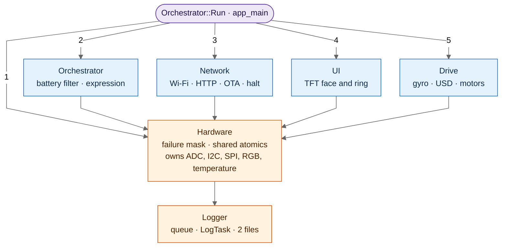
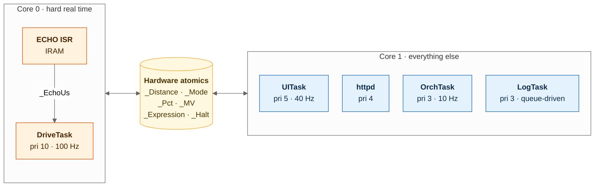
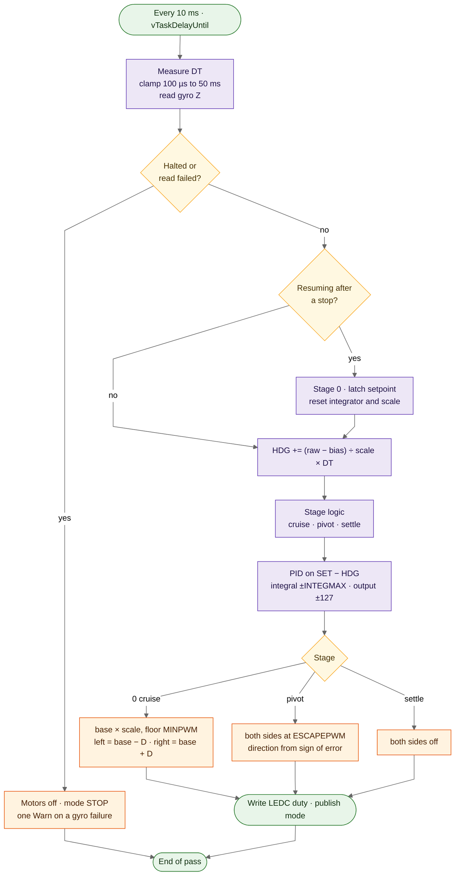
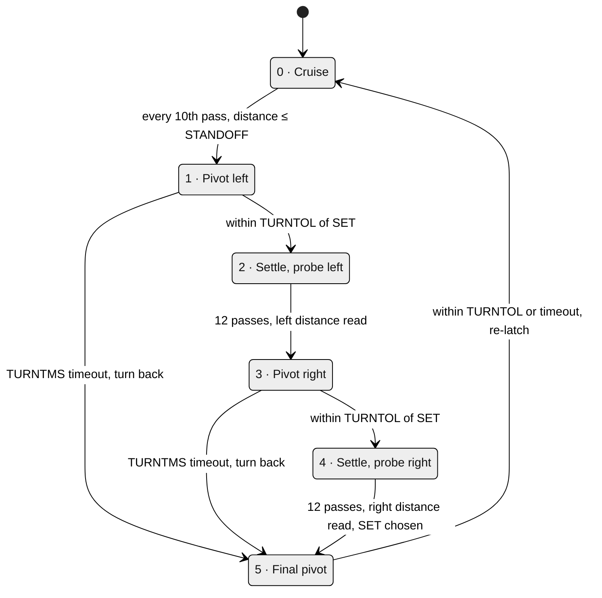
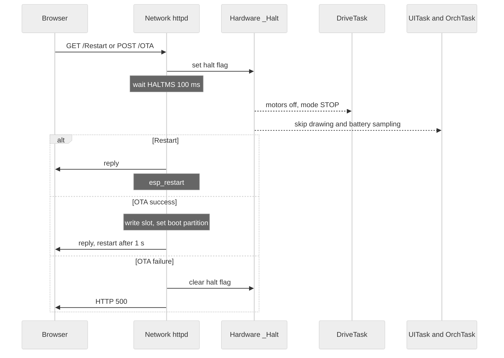
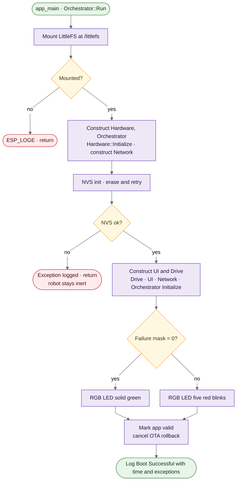
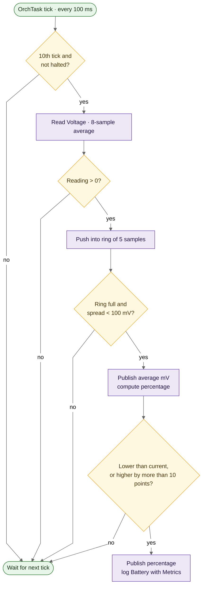
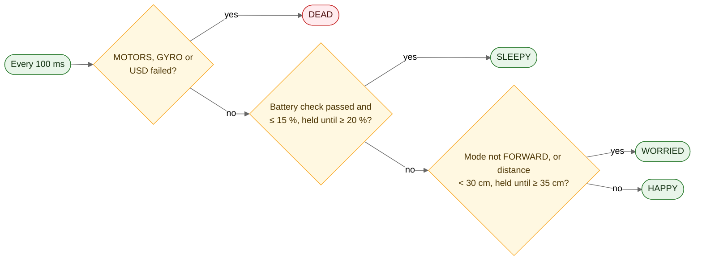
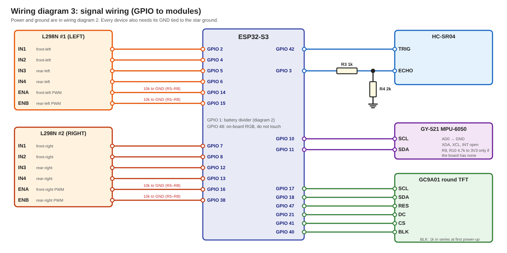

# Software Design Document

**Anusmarak — Autonomous Personal Assistant Robot**

---

|Field|Detail|
|---|---|
|**Document ID**|ANUSMARAK-SDD-001|
|**Version**|1.0.0|
|**Status**|Approved|
|**Prepared By**|Team Engram|
|**Date**|October 19, 2026|

---

## Team

|Role|Name|Roll Number|Email|
|---|---|---|---|
|Team Lead|Dhritiman Modak|24155767|24155767@kiit.ac.in|
|POC|Asmit Kumar Jena|24155017|24155017@kiit.ac.in|
|Member A|Aryan Pattanaik|24155759|24155759@kiit.ac.in|
|Member B|Saumil Karn|2405966|24055966@kiit.ac.in|
|Member C|Aman Gupta|2405932|2405932@kiit.ac.in|
|Member D|Harsh Dayma|24052145|24052145@kiit.ac.in|

---

## Table of Contents

1. Introduction
2. Design Constraints and Coding Standards
3. Architectural Overview
4. Module Design
    - 4.1 Utilities (Configuration, Logger, Timer)
    - 4.2 Hardware
    - 4.3 Drive
    - 4.4 UI
    - 4.5 Network
    - 4.6 Orchestrator
5. Data Design
6. Interface Design
7. Memory Design
8. Error Handling Strategy
9. Build Configuration

Appendix A: Class Index · Appendix B: File Tree

---

## 1. Introduction

### 1.1 Purpose

This Software Design Document describes the architecture, modules, data and interfaces of the **Anusmarak** firmware as built. It is the design companion of ANUSMARAK-SRS-001. The firmware source is the final authority: where this document and the code differ, the code is correct and the document is updated to match. Class declarations are not repeated here; they live in `Utilities.hpp` and `Orchestrator.hpp`.

### 1.2 Scope

This document covers all firmware executing on the ESP32-S3-WROOM-1-N16R8: every class, its responsibilities, its interface and its FreeRTOS task or ISR binding. Hardware bring-up procedures, PCB layout and mechanical design are out of scope.

### 1.3 Definitions and Acronyms

Definitions from ANUSMARAK-SRS-001 §1.3 apply. Additional terms:

|Term|Definition|
|---|---|
|**SDD**|Software Design Document|
|**NVS**|Non-Volatile Storage; the ESP-IDF key-value store in flash, required by the Wi-Fi driver|
|**POST**|Power-on self-test: the check of each device that a class runs in its own `Initialize()`|
|**Failure mask**|The `uint16_t` kept by `Hardware`; one bit per device reported as failed, 0 when every device passed|
|**Halt**|The atomic flag in `Hardware` that tells `Drive`, `UI` and `Orchestrator` to stand down (OTA, restart)|
|**Stage**|The state of the `Drive` loop: 0 cruise, 1–5 the escape manoeuvre (§4.3)|
|**Expression**|HAPPY, WORRIED, SLEEPY or DEAD; computed by `Orchestrator`, published on the dashboard|
|**Face / Ring**|The two blinking eyes on the TFT / the full-circle battery band at its edge|
|**LF**|The log-target enumeration (`Configuration::Logger::LF`); a value names the file `/littlefs/Logs/<name>.log`|
|**Hot path**|Code that runs on Core 0 inside the control loop or ISR: `Drive::_Task`, `Drive::_EchoISR`, `Drive::_Ping`, `Drive::_Motors`|

### 1.4 References

|Document|Source|
|---|---|
|ANUSMARAK-SRS-001 v1.0.0|Team Engram, October 19, 2026|
|ESP-IDF Programming Guide v6.1|Espressif Systems, 2026|
|ESP32-S3 Technical Reference Manual v1.3|Espressif Systems, 2024|
|ESP32-S3-WROOM-1 Datasheet (pin descriptions, strapping pins, octal-PSRAM note)|Espressif Systems, 2024|
|GC9A01 Datasheet|Galaxycore|
|FreeRTOS Reference Manual v10.x|Real Time Engineers Ltd.|

### 1.5 Document Overview

Section 2 states the constraints and coding standards. Section 3 describes the architecture and task map. Sections 4–8 specify modules, data, interfaces (including the GPIO allocation), memory and error handling. Section 9 lists the build configuration. Appendices give a class index and the file tree.

---

## 2. Design Constraints and Coding Standards

### 2.1 Firmware Design Constraints

|Constraint|Specification|
|---|---|
|**Framework**|ESP-IDF v6.1.0; C++23; no Arduino layer|
|**Language features**|`std::string_view`, `std::format_to_n`, `std::array`, `std::atomic`, `constexpr`, `inline static` members. No C varargs, raw C arrays or macros for constants|
|**Design priorities**|Memory allocation first, then execution speed, then source compactness. A choice that trades one against another is recorded in the affected class's notes|
|**Constants**|Every constant, enumeration and table that does not change at run time lives in `Utilities/Configuration.hpp`, one namespace per owner (§4.1.1). Classes declare none. There is no runtime configuration file; changing a value means rebuilding|
|**Construction model**|Each subsystem is a class. The objects are function-local `static` instances inside `Orchestrator::Run()`, constructed in dependency order after LittleFS is mounted, and receive the objects they depend on by reference. `Initialize()` is `void`: each one checks its IDF return codes, reports the device result to `Hardware`, and starts the class's task as its last step. The first `Logger` constructed (inside `Hardware`) creates the log queue and starts `LogTask`; a failure there asserts, because nothing can be logged yet|
|**Device ownership**|`Hardware` owns the chip temperature sensor, the RGB LED, the battery ADC, the I2C bus and the SPI bus. `Drive` owns the motors, the gyroscope device on the I2C bus and the USD. `UI` owns the TFT device and its pins. `Network` owns the Wi-Fi station and the HTTP server. The TFT backlight (GPIO 40) is configured and switched on by `UI` only. Every other device has one user|
|**Allocation**|Task stacks, the log queue and working buffers are allocated once in `Initialize()` (plain `xTaskCreatePinnedToCore`, `xQueueCreate`, `std::array` members of static objects), in internal RAM, with compile-time sizes. Stack sizes are provisional until measured with `uxTaskGetStackHighWaterMark()`|
|**PSRAM**|Enabled but not used by the firmware (§7.1)|
|**No dynamic allocation after boot**|Firmware code allocates only inside `Initialize()` calls. Exempt: allocations inside IDF components (Wi-Fi, HTTP server, drivers) and the HTTP handlers (`fopen` in `_Logs`), which run per request|
|**Single-precision FP**|The ESP32-S3 FPU is single-precision; `double` is software-emulated. Use `float` and `f` literals|
|**Single writer**|Motor outputs (LEDC duties and direction pins) are written only by `DriveTask`, inside `Drive`. The only external input to `Drive` is the halt flag; there is no lock anywhere in the firmware|
|**Hot path rules**|On the hot path: no heap, no mutexes or spinlocks, no file I/O, no blocking except the task's own `vTaskDelayUntil`, the 10µs TRIG busy-wait in `Drive::_Ping`, and one bounded I2C transaction per pass. Logging is event-driven through `Logger`: a call formats into a stack buffer and does a non-blocking queue send; printing and file writes happen in `LogTask`. Values shared with other tasks travel by `std::atomic`. The ISR and everything it calls are `IRAM_ATTR` and registered with `ESP_INTR_FLAG_IRAM`|
|**Flash-write stall**|A flash write (log flush, OTA) disables the flash cache for its duration; both cores stall and only IRAM-safe ISRs run. Task code on Core 0 cannot avoid this. The control loop therefore integrates with measured `DT` (clamped to 100µs–50ms), and the ISR stays IRAM-safe. The stall duration is to be measured with `Timer` inside `Logger::_ProcessQueue`|
|**ISR isolation**|`Drive::_EchoISR` reads the ECHO pin and stores a timestamp or a pulse width in an atomic; no logic beyond that|
|**Core pinning**|`DriveTask` and the ECHO ISR on Core 0; `UI`, `Logger`, `Orchestrator`, `httpd`, Wi-Fi and lwIP on Core 1 (§9). `Drive::Initialize()` runs on the IDF main task, pinned to Core 0, so the ISR is allocated on Core 0|
|**Halt protocol**|`Network::_Stop()` sets the halt flag and waits `HALTMS`. `Drive` de-energises the motors and re-latches on resume; `UI` skips drawing; `Orchestrator` skips battery sampling (§4.5)|
|**ADC2 prohibition**|ADC2 shall not be used; it is hardware-shared with the Wi-Fi radio|
|**Reserved GPIO**|See §6.2: 0, 45, 46 (strapping), 19/20 (USB), 22–25, 26–32, 33–34, 35–37 shall not be assigned. GPIO 3 is a strapping pin used as an input (§6.2)|
|**Exception handling**|C++ exceptions are off (the IDF default); error propagation uses the failure mask. `ESP_ERROR_CHECK` is not used: every `Initialize()` checks IDF return codes and reports the failure|
|**Tick rate**|`CONFIG_FREERTOS_HZ=1000`; periods are expressed through `pdMS_TO_TICKS()`|
|**Layout**|`Logger`, `Timer`, `Hardware`, `Drive`, `UI` and `Network` are declared in `Utilities/Utilities.hpp` and defined in `Utilities.cpp`; `Orchestrator` has its own pair in `main/`|

### 2.2 Coding Standards

|Rule|Detail|
|---|---|
|**Naming — Classes**|PascalCase; all-caps for established acronyms (`UI`); e.g. `Drive`, `Orchestrator`|
|**Naming — Methods**|PascalCase; e.g. `Initialize()`, `Voltage()`|
|**Naming — Private members**|`_` prefix + PascalCase, or `_` prefix + ALL-CAPS for abbreviations; e.g. `_Board`, `_Mode`, `_EchoUs`. The underscore is used for this purpose only|
|**Naming — Locals and abbreviated parameters**|1–5 letter ALL-CAPS for universally understood abbreviations; e.g. `I`, `E`, `DT`, `HDG`, `SET`, `OUT`, `DIST`, `LS`/`RS`, `PCT`, `MSG`, `ARGS`. Full-word names stay PascalCase|
|**Naming — Constants**|ALL-CAPS, no underscores; e.g. `DEFAULTSPEED`, `HDGKP`, `TURNTOL`|
|**Naming — Instances, files, directories**|PascalCase, ALL-CAPS for abbreviations. Exempt: toolchain-mandated names (`CMakeLists.txt`, `partitions.csv`, `sdkconfig.defaults`), IDF partition names and the mount point `/littlefs`|
|**Class header comment**|Every class or namespace definition opens with `// ------- Name -------`|
|**Vertical compactness**|Single-condition guards and trivial assignments on one line; no blank lines between member declarations; no redundant intermediate variables|
|**No throwaway variables**|A variable is declared only if it is read more than once, used in a non-trivial expression, or required by an API taking a pointer|
|**No redundant wrappers**|A function exists only if it is called from more than one site or isolates two layers|
|**Constants**|Declared in `Configuration.hpp` and referenced qualified (`Configuration::Drive::HDGKP`). Enumerations are plain (unscoped) enums with a fixed underlying type|
|**Logging**|Modules never call `ESP_LOG*` directly. Each class that logs owns one `Logger _Log{TAG, FILE}` member, where `FILE` is an `LF` value. Exception: `Orchestrator::Run()` before the first `Logger` exists (LittleFS failure) uses `ESP_LOGE`|

---

## 3. Architectural Overview

### 3.1 System Decomposition

Six classes in one component folder, plus the `Orchestrator` in `main/`.

```
main/
├── Orchestrator.hpp/.cpp — boot sequence, battery filter, Expression; defines app_main()
Utilities/ — Configuration.hpp (constants); Utilities.hpp/.cpp: Logger, Timer, Hardware, Drive, UI, Network; Status.html
```

Dependencies point strictly downward. This graph is also the construction order in `Orchestrator::Run()`; each object receives the ones it depends on by reference.



_Class dependencies. The numbers are the construction order in `Orchestrator::Run()`; every class also includes `Configuration.hpp`._

`Initialize()` order: `Hardware`, NVS, `Drive`, `UI`, `Network`, `Orchestrator`. `Timer` is a leaf utility; `Run()` and the `Initialize()` methods each use a local instance. `Configuration` is included by every class.

### 3.2 FreeRTOS Task Map

Sorted by effective priority (larger number = higher priority). Priority, core and stack are the `PRIORITY`, `CORE` and `STACK` constants of the owner's namespace.

|Task Name|Class|Core|Priority|Stack|Rate / Trigger|
|---|---|---|---|---|---|
|`DriveTask`|`Drive`|0|10|4KB|100Hz (10ms, `vTaskDelayUntil`); gyro, heading hold, escape, motors; ultrasonic every 10th pass|
|`UITask`|`UI`|1|5|4KB|40Hz (25ms, `vTaskDelayUntil`); face and ring|
|`httpd`|`Network` (IDF)|1|4|IDF default|Per HTTP request|
|`LogTask`|`Logger`|1|3|4KB|Queue-driven|
|`OrchTask`|`Orchestrator`|1|3|4KB|10Hz (100ms, `vTaskDelayUntil`); battery, Expression|

The ECHO ISR is pinned to Core 0 and writes an atomic read by `DriveTask`. `DriveTask` is periodic because no MPU-6050 interrupt pin is allocated.



_Task and ISR placement by core; tasks share state through `Hardware` atomics (§3.4) and log through the queue to `LogTask`._

### 3.3 Core Pinning Strategy

**Core 0** handles the hard-real-time work: the 100Hz loop (gyro, heading hold, escape, motor output, distance) and the ECHO ISR. Wi-Fi, lwIP and the other firmware tasks are on Core 1 by the `sdkconfig` pinning in §9. Core 0 is not isolated from flash-write stalls (§2.1).

**Core 1** handles everything else: TFT rendering, the HTTP server, logging (file writes) and battery filtering.

### 3.4 Inter-Task Communication

|Producer|Consumer|Mechanism|Payload|
|---|---|---|---|
|`Drive::_EchoISR`|`DriveTask`|`std::atomic<uint32_t>` `_EchoUs`, read and cleared with `exchange(0)`|Pulse width in µs; 0 = none yet|
|`DriveTask`|`OrchTask`, `httpd`|`Hardware::_Distance` (`std::atomic<float>`)|Latest distance in cm|
|`DriveTask`|`OrchTask`|`Hardware::_Mode` (`std::atomic<Action>`)|STOP, FORWARD, LEFT or RIGHT|
|`Network::_Stop`|`DriveTask`, `UITask`, `OrchTask`|`Hardware::_Halt` (`std::atomic<bool>`)|Stand-down flag|
|`OrchTask`|`UITask`, `httpd`|`Hardware::_Pct`, `Hardware::_MV` (`std::atomic`)|Battery percentage and millivolts|
|`OrchTask`|`httpd`|`Hardware::_Expression` (`std::atomic<Expression>`)|Expression|
|Any `Logger` instance|`LogTask`|Shared `QueueHandle_t`, depth `DEPTH` (16)|`Logger::Entry` (§4.1.2)|

`Hardware::_Exceptions` is a plain `uint16_t`, written only during boot on the main task, before the tasks that read it start.

---

## 4. Module Design

Each class is specified as a responsibility and a function table (function, contract, implementation). Values are cited by name from `Configuration.hpp`; §5.2 lists them.

### 4.1 Utilities (`Utilities/`)

#### 4.1.1 `Configuration.hpp`

Header-only. Holds every constant, enumeration and table that does not change at run time. One namespace per owner; no class declares a constant.

|Namespace|Contents|
|---|---|
|`Logger`|`LF`, `LVL`, `PATHS`, `LEVELS`, `DEPTH`, `MSGLEN`, `TIMELEN`, `BUFLEN`, task `STACK`/`PRIORITY`/`CORE`|
|`Timer`|`TH`, `TM`, `TS`, `TMS`, `BUFLEN`|
|`Hardware`|`Device`, `DEVICES`, `Expression`, `NAMES`; every pin array and pin; bus, PWM, ADC, gyro, USD and battery constants|
|`Network`|Hotspot `SSID` and `PASS`, URI strings, `HALTMS`, task `PRIORITY`/`CORE`|
|`Drive`|Speeds, heading and distance gains, `STANDOFF`, `TURNDEG`, `TURNTOL`, `TURNTMS`, pass counts, task values|
|`Actions`|`Action`|
|`UI`|Display geometry, `REFRESHRATE`, `STRIPROWS`, eye and ring constants, TFT command bytes, delays and the GC9A01 init sequence, task values|
|`Orchestrator`|Battery filter constants, expression thresholds, task values|

`Device` and `Action` are plain enums, so they convert to integers without a cast. `DEVICES` parallels `Device` and `NAMES` parallels `Expression`; each is indexed by the enum value. The hotspot credentials are held in `Network`; they are rotated and are not recorded in this document.

#### 4.1.2 `Logger`

Asynchronous logger. Callers format into a fixed entry and queue it; one worker prints and writes. The sole writer of the log files.

|Function|Contract|Implementation|
|---|---|---|
|`Logger(M, F)`|Binds a tag and a target file|Stores `M` and `F`. If `_Queue` is null, creates it (`DEPTH` × `sizeof(Entry)`) and starts `LogTask` (an `assert` on failure). If the target's file descriptor is still closed, opens `PATHS[F]` with `O_WRONLY \| O_CREAT \| O_TRUNC` (every run starts with empty logs). A file that fails to open leaves a negative descriptor: that target is console-only|
|`Trace`, `Metrics`, `Warn`, `Exception`|Log at one level|One-line forwards to `_Log` with the level. `Trace` is defined and unused; `Metrics` is a milestone or measurement, `Warn` a recoverable problem, `Exception` a failure|
|`_Log(L, F, ARGS)`|Queues one entry, never blocks|Formats into `Entry.MSG` on the caller's stack with `std::format_to_n` (excess truncated, always terminated), then `xQueueSend(_Queue, &I, 0)`. A full queue drops the entry. No heap; nothing is printed or written by the caller|
|`_ProcessQueue(P)`|Worker: prints and persists each entry|Per entry builds `[HH:MM:SS] - [Level] [Tag] message` in a 136-byte stack buffer, with the time from the uptime clock; writes it to stdout (the USB Serial/JTAG port); writes it to the target's descriptor and calls `fsync`. A write failure is not reported or retried|

The entry is 88 bytes (4 + 1 + 1 + 82), so the queue is 16 × 88 = 1,408 bytes. One `fsync` per line keeps the files readable across unclean power cycles.

Instance assignment:

|Class|Instance|Tag|Target (`LF`)|
|---|---|---|---|
|`Orchestrator`|`_Log`|`ORCHESTRATOR`|`ORCHESTRATOR`|
|`UI`|`_Log`|`UI`|`ORCHESTRATOR`|
|`Network`|`_Log`|`NETWORK`|`ORCHESTRATOR`|
|`Hardware`|`_Log`|`HARDWARE`|`HARDWARE`|
|`Drive`|`_Log`|`DRIVE`|`HARDWARE`|

#### 4.1.3 `Timer`

Measures elapsed time and formats it as text. Leaf utility; one instance per owner, used on one task only.

|Function|Contract|Implementation|
|---|---|---|
|`Timer()`|Starts timing|Calls `Start()`|
|`Start()`|Restarts the timer|`_T0 = _Now()`|
|`Raw()`|Nanoseconds since `Start()`|`_Now() - _T0`; used by `Drive::_Task` for `DT`|
|`Elapsed()`|Text of the time since `Start()`|`_F(Raw())`; the view is valid until the next call on the same instance|
|`_Now()`|Monotonic time in nanoseconds|`esp_timer_get_time()` (1µs resolution) × 1000|
|`_F(NS)`|Scaled text in `_BUF`|`std::format_to_n` into `_BUF`; `≥3600s` → `{H}H {M}M`, `≥60s` → `{M}M {S}s`, `≥1s` → `{:.2f}s`, `≥1ms` → `{:.2f}ms`, otherwise `{:.2f}μs`. No heap|

Instances: locals in `Orchestrator::Run()` and in each `Initialize()`, and `Drive::_Task`.

---

### 4.2 Hardware

Holds the failure mask and the shared state that crosses tasks, and owns the devices listed in §2.1. The other classes reach its private members as friends (`Drive`, `UI`, `Network`, `Orchestrator`).

|Function|Contract|Implementation|
|---|---|---|
|`Initialize()`|Sets up and checks the devices `Hardware` owns|See the steps below|
|`_Report(D, X)`|Sets (`X` true) or clears the failure bit of device `D`; friends only|`_Exceptions \|= D` or `&= ~D`. Nothing is logged here; the result is listed in the boot line|
|`Exception(D)`, `Exceptions()`|Query the mask|`_Exceptions & D`; the whole mask|
|`Summary()`|The failed devices as text|Joins `DEVICES[I]` for each set bit with `,` into `_BUF`; `None` when the mask is 0|
|`Temperature()`|Chip temperature in °C|`temperature_sensor_get_celsius`; 0 if the sensor is absent|
|`RGB(R, G, B)`, `BLK(N, R, G, B)`|On-board LED|`RGB` sets pixel 0 and refreshes; `BLK` blinks `N` times (150ms on, 150ms off), then waits 1 second|
|`Voltage()`|Battery-side millivolts, 0 on failure|Averages `BATSAMPLES` `adc_oneshot_read` samples through `adc_cali_raw_to_voltage`, then `mV × BATNUM / (BATSAMPLES × BATDEN)` in integer arithmetic|
|`Charge(MV)`|Static; percentage from millivolts|0 at or below `BATMIN`, 100 at or above `BATMAX`, otherwise `(MV − BATMIN) / BATSPAN`|
|`PCT()`, `MV()`, `Distance()`, `Mode()`, `Halted()`, `EXPR()`, `SetExpression()`|Relaxed atomic accessors|One-line loads and stores of the atomics in §3.4; `EXPR()` returns `NAMES[Expression]`|
|`I2C()`, `SPI()`|Bus handles for the device owners|The I2C bus handle; `SPI2_HOST`|

`Initialize()` steps, none of which stops the others:

1. **Temperature:** `temperature_sensor_install` (20–100°C range) and enable. Reported as `TEMPERATURE`.
2. **RGB:** `led_strip` on GPIO 48 (WS2812, one LED, RMT at 10MHz). Reported as `RGB`.
3. **Battery:** ADC1 one-shot on ADC1_CH0, 12dB attenuation, curve-fitting calibration. One `Voltage()` read must be above 0; the published millivolts and percentage start from it. Reported as `BATTERY`.
4. **I2C bus:** master bus on `SCLPIN`/`SDAPIN`, port 0, internal pull-ups, glitch filter 7. Reported as `GYRO` (`Drive` reports again after probing the sensor).
5. **SPI bus:** SPI2 on the TFT clock and data pins, no MISO, DMA automatic, `max_transfer_sz` of one strip. Reported as `TFT` (`UI` reports again after the device).

The device bits and their checks:

|Device|Reported by|Check|
|---|---|---|
|`TEMPERATURE`|`Hardware`|Install and enable return `ESP_OK`|
|`RGB`|`Hardware`|LED strip creation returns `ESP_OK`|
|`BATTERY`|`Hardware`|ADC set-up returns `ESP_OK` and the first read is above 0|
|`MOTORS`|`Drive`|Every GPIO and LEDC return code `ESP_OK`|
|`GYRO`|`Hardware`, `Drive`|I2C bus created; MPU ACK; `WHO_AM_I` = `GYROADDR`; more than `BIASN / 2` bias samples read|
|`USD`|`Drive`|ISR set-up `ESP_OK`; one `_Ping()` produces a completed echo within `POSTMS`|
|`TFT`|`Hardware`, `UI`|SPI bus and device creation, pin set-up and every init command `ESP_OK`|
|`SERIAL`|—|Reserved bit; no class reports it|
|`WIFI`|`Network`|Wi-Fi driver set-up returns `ESP_OK`. An unreachable hotspot is not a failure|

---

### 4.3 Drive

Owns the motors, the MPU-6050 and the HC-SR04. One task, `DriveTask`, runs the heading hold, the distance law, the escape manoeuvre and the motor outputs at 100Hz on Core 0. It takes no external command: the only input from another task is the halt flag.

|Function|Contract|Implementation|
|---|---|---|
|`Initialize()`|Sets up and checks the motors, gyroscope and USD; starts `DriveTask` only if all three passed|See the steps below|
|`_Task()`|The 100Hz control loop|Stage table and rules below|
|`_Ping()`|Starts one ultrasonic measurement|TRIG high, `esp_rom_delay_us(10)`, TRIG low|
|`_Motors(LF, RF, LS, RS)`|Sets both sides|Per motor, IN1 = forward and IN2 = not forward on its side's pins (`DIRS`, left pins 0–3, right 4–7); then `ledc_set_duty` and `ledc_update_duty` (left CH0/CH1 with `LS`, right CH2/CH3 with `RS`)|
|`_EchoISR(P)`|Captures the echo pulse width|Any-edge handler (`P` = `this`), `IRAM_ATTR`. On the rising edge stores the time in `_EchoStart`; on the falling edge stores `uint32_t(Now − _EchoStart)` into `_EchoUs`|

`Initialize()` steps, none of which stops the others:

1. **Motors:** the 8 `DIRS` pins as outputs, driven low; one LEDC timer (`PWMBITS`, `PWMHZ`, low-speed) and channels CH0–CH3 on `ENS`. Reported as `MOTORS`.
2. **Gyro:** MPU-6050 (`GYROADDR`) added on the bus from `Hardware` at `I2CHZ`; woken, ±500°/s, 44Hz low-pass (`GYROINIT`); `WHO_AM_I` checked; `BIASN` stationary gyro-Z samples taken 10ms apart (about 2 seconds) and averaged into `_Bias`. The robot must be stationary at power-on. Reported as `GYRO`.
3. **USD:** `TRIGPIN` as output (low); `ECHOPIN` as input with a pull-down and an any-edge interrupt; `gpio_install_isr_service(ESP_INTR_FLAG_IRAM)` (already-installed is accepted) and `gpio_isr_handler_add`; one `_Ping()`, then wait `POSTMS` for `_EchoUs` to become non-zero. A working HC-SR04 holds ECHO high about 38ms with nothing in range, so it always completes a pulse inside the window. Reported as `USD`.
4. **Task:** if `MOTORS`, `GYRO` or `USD` failed, no task is created and the motor pins stay low. Otherwise `DriveTask` is created with `xTaskCreatePinnedToCore` and a non-capturing lambda passing `this`; a failed creation logs with `Exception`.

`_Task()` pass, every 10ms:

1. Wait with `vTaskDelayUntil`; `DT` = measured time since the last pass, clamped to 100µs–50ms.
2. Read gyro Z (one I2C transaction, 100ms timeout). If the halt flag is set or the read failed: log `Warn` once on a gyroscope failure, mark the loop not running, publish STOP, de-energise the motors and end the pass.
3. When the loop resumes after being stopped: stage 0, setpoint = heading, integrator and derivative reset, speed scale 100, pass counter 0.
4. Heading `HDG += (raw − _Bias) / GYROSCALE × DT`. Positive heading is counter-clockwise.
5. Run the stage logic below.
6. Heading PID on `ERR = SET − HDG`: integral clamped to ±`INTEGMAX`, output clamped to ±127 as the differential `D`.
7. Mix and drive: in stage 0, base `B = max(DEFAULTSPEED × scale × 0.01, MINPWM)`, left `B − D`, right `B + D`, both forward, clamped to 0–255. In a pivot stage, both sides at `ESCAPEPWM`, left forward if `ERR < 0`, right forward if `ERR > 0`. In a settle stage, both off. Publish the mode: FORWARD in stage 0; LEFT or RIGHT in a pivot (by the sign of `ERR`); STOP in a settle.



_One `DriveTask` pass._

Stages:

|Stage|Name|Entry|Exit|
|---|---|---|---|
|0|Cruise|Boot, resume, or end of stage 5|Every 10th pass: read and clear the echo, compute distance (µs ÷ `USDIV`, clamped to `USMAX`; no echo = `USMAX`), publish it, update the PD scale `clamp(PDKP×EP + PDKD×(EP−PEP)/0.1, 0, 100)` with `EP = distance − STANDOFF`. If distance ≤ `STANDOFF`: base heading latched, `SET = base + TURNDEG`, stage 1, log the distance (`Metrics`). Otherwise `_Ping()`|
|1|Pivot left|From stage 0|Ends within `TURNTOL` of `SET`, or after `TURNTMS` (a timeout is logged); then stage 2|
|2|Settle, probe left|From stage 1|12 passes: clear the echo and `_Ping()` when 6 remain; at 0 read the distance (left), `SET = base − TURNDEG`, stage 3|
|3|Pivot right|From stage 2|As stage 1; then stage 4|
|4|Settle, probe right|From stage 3|As stage 2, then the right distance is read and `SET` is chosen: both ≤ `STANDOFF` → `base − 2×TURNDEG` (turn back); left > right → `base + TURNDEG`; otherwise `base − TURNDEG`. Stage 5|
|5|Final pivot|From stage 4, or a timed-out probe|As stage 1; the heading is then re-latched and cruise (stage 0) resumes|



_Escape stages. Every timeout from a probe pivot goes to stage 5 with the turn-back heading._

Behaviour rules:

|Behaviour|Rule|
|---|---|
|Latch|Cruise starts, and every manoeuvre ends, with the setpoint at the current heading and the integrator and derivative reset|
|Heading hold|PID on heading error, output clamped to ±127 as a PWM differential. In stage 0 the right pair gets `B + D` and the left pair `B − D`; the distance scale multiplies the base only, never `D`. The integral is clamped so a blocked chassis cannot wind it up|
|Pivots|Open-loop rotation in place at `ESCAPEPWM` in the direction of the heading error; the PID output is not used as pivot speed because near the target it falls below the motor dead-band and the robot would stall short. Coast is tuned through `TURNTOL`; `MINPWM` and `ESCAPEPWM` are provisional|
|Gyro failure|The sample is dropped: motors off, mode STOP, one `Warn`; cruise resumes when reads recover|
|Distance|10Hz. An echo of 0 means no echo this cycle and counts as `USMAX`; silence never triggers an escape|
|PD law|`PDKP` is in %/cm, `PDKD` in %/(cm/s). The scale applies only in stage 0 and resets to 100 whenever the loop re-latches|
|Measured `DT`|Taken from `Timer::Raw()` and clamped, so a flash-write stall produces neither a derivative spike nor a huge integration step|

---

### 4.4 UI

Owns the TFT device and its pins. Draws the face and the battery ring. It has no inputs other than the battery percentage and the halt flag.

|Function|Contract|Implementation|
|---|---|---|
|`Initialize()`|Sets up and checks the TFT, starts `UITask`|See the steps below|
|`_Task()`|One pass every `1000 / REFRESHRATE` ms (`vTaskDelayUntil`)|Rules below|
|`_Display(CMD, DAT, LEN)`|Sends one command and its data|CS is handled by the SPI driver; DC low for the command byte, high for the data bytes; two `spi_device_transmit` calls. Returns the combined error|

`Initialize()` steps:

1. **Device and pins:** `spi_bus_add_device` on the SPI2 bus from `Hardware` (`SPIHZ`, chip select on `TFTPINS[4]`); DC, RES and BLK as outputs.
2. **Reset and init:** RES low for `TFTDELA`, high, wait `TFTDELB`; then the GC9A01 init sequence `TFTINIT` (command, parameter count with a delay flag in bit 7, parameters), waiting `TFTIDEL` where the flag is set.
3. **Task:** only if every step returned `ESP_OK`; the task is created with a non-capturing lambda. The backlight stays off until the task's first complete frame, so a failed panel stays dark. Reported as `TFT`.

`_Task()` pass:

|Part|Rule|
|---|---|
|Halt|A halted pass does nothing|
|Eyes|A frame counter runs 0–99; for its first `BLINKFRAMES` passes the eye height is 4 px, otherwise `EYEH`. Two rectangles of width `EYEW` centred `EYEDX` left and right of the screen centre, colour `EYECOLOR`, drawn in an eye window clear of the ring (columns `EYECOLS`, strips `EYESTARTSTRIP`–`EYEENDSTRIP`). Redrawn only when the height changes|
|Ring|A full circle between radii `RINGIN` and `RINGOUT`, coloured by the battery band: `RINGCOLORS[3]` (red) at or below `RINGLIMITS[2]`, `[2]` (orange) at or below `[1]`, `[1]` (yellow) at or below `[0]`, otherwise `[0]` (green). On a band change the whole screen is redrawn strip by strip (ring pixels in the band colour, everything else black), the eye state is invalidated so the eyes are redrawn next, and the backlight is switched on after the first such frame|
|Strips|Each strip is `STRIPROWS` rows × `WIDTH` pixels in `_Strip` (RGB565); a CASET/RASET window is set, the first strip uses `RAMWR` and the rest `RAMWRC`. No frame buffer exists. A pass with no change sends nothing over SPI|

`UI` consumes the filtered battery percentage, which `Orchestrator` publishes only when the voltage window is stable, so the ring does not redraw on a transient sag. It does not use the expression: the eyes are the same in every mood.

---

### 4.5 Network

Owns the Wi-Fi station and the HTTP server. Also drives the halt protocol for OTA and restart.

|Function|Contract|Implementation|
|---|---|---|
|`Initialize()`|Joins the hotspot, starts mDNS and the HTTP server|See the steps below|
|`_Reconnect(…)`|Event handler|Calls `esp_wifi_connect()`; registered for `WIFI_EVENT_STA_START` and `WIFI_EVENT_STA_DISCONNECTED`, so every disconnect retries|
|`_Stop()`|Halts the robot|Sets the halt flag and waits `HALTMS`|
|`_HTML(REQ)`|`GET /`|Sends `Status.html` (embedded with `EMBED_TXTFILES`) from flash in one call; no RAM copy|
|`_Logs(REQ)`|`GET /Logs/*`|Opens `/littlefs` + the request URI, streams it in 256-byte chunks as `text/plain`; 404 if it does not open|
|`_Telemetry(REQ)`|`GET /Telemetry`|Formats a JSON object into a 256-byte stack buffer: `BPCT`, `BVLT`, `Temperature`, `Expression`, `RSSI`, `Exceptions`, `Uptime`, `USD`|
|`_Restart(REQ)`|`GET /Restart`|Logs, replies, `_Stop()`, `esp_restart()`|
|`_OTA(REQ)`|`POST /OTA`|`_Stop()`; picks the next update partition and begins; reads the body in 1KB chunks into `esp_ota_write` (a timeout is retried); on success sets the boot partition, replies and restarts after 1 second. On any error aborts, clears the halt flag, logs `Warn` and answers 500|



_Halt protocol for restart and OTA (§4.5)._

`Initialize()` steps:

1. **Station:** `esp_netif`, default event loop, default station netif; Wi-Fi initialised and started in station mode with the configured `SSID` and `PASS` (WPA2-PSK minimum); `WIFI_PS_MIN_MODEM`; `_Reconnect` registered; `esp_wifi_connect()`.
2. **Address:** waits up to 4 seconds (40 × 100ms) for an address, so boot time is bounded; logs the address and the MAC. Reported as `WIFI` from the driver set-up result only.
3. **Services:** skipped when `WIFI` failed. mDNS hostname `Anusmarak`; `httpd_start()` on Core 1 at priority `PRIORITY` with wildcard URI matching; five handlers registered, each receiving the `Network` pointer through `user_ctx`. A failure logs with `Exception`.

The dashboard (`Status.html`) polls `/Telemetry` every 2 seconds, shows OFFLINE after 4 seconds without an answer, charts the last 60 distance samples, polls the selected log every 3 seconds, and asks for confirmation before Restart. Its chart library and fonts load from public CDNs, so the browser needs internet access. The restart and OTA endpoints are unauthenticated by design (SRS NFR-11).

---

### 4.6 Orchestrator

Runs the boot sequence, filters the battery reading and computes the expression.

```cpp
// ------- Orchestrator -------
class Orchestrator { static void Run(); void Initialize(); /* private: _Task, _Board, _Log */ };
```

`Orchestrator.cpp` also defines `extern "C" void app_main() { Orchestrator::Run(); }`; there is no separate `main.cpp`. IDF starts the scheduler before `app_main()`; the tasks started by the `Initialize()` calls begin executing immediately. `app_main` runs on the IDF main task, pinned to Core 0 (§9).

`Run()` steps:

|Step|Action|
|---|---|
|1|Mount LittleFS (`esp_vfs_littlefs_register`, base path `/littlefs`, partition `littlefs`, `format_if_mount_failed = true`). On failure `ESP_LOGE` and return. A fresh or erased flash needs a one-time `mkdir("/littlefs/Logs")`, kept as a commented line in `Run()`|
|2|Construct `Hardware`, then `Orchestrator`; `Hardware::Initialize()`; construct `Network`|
|3|NVS init with erase-and-retry (`NO_FREE_PAGES`, `NEW_VERSION_FOUND`). On failure log `Exception` and return|
|4|Log the running partition label and subtype|
|5|Construct `UI` and `Drive`; `Drive::Initialize()`, `UI::Initialize()`, `Network::Initialize()`, `Orchestrator::Initialize()`|
|6|Status LED: solid dim green if the failure mask is 0, otherwise five red blinks|
|7|`esp_ota_mark_app_valid_cancel_rollback()`|
|8|Log `Boot Successful: [{time}] \| Exceptions: [{Summary}]` and return|



_Boot sequence of `Orchestrator::Run()`._

`Initialize()` starts `OrchTask` (`xTaskCreatePinnedToCore`, non-capturing lambda); a failed creation logs with `Exception`.

`_Task()` pass, every `TICKMS` (100ms):

|Part|Rule|
|---|---|
|Battery|Once per second (every `SAMPLEMOD` ticks), unless halted, read `Voltage()`; a non-zero reading goes into a ring of `SAMPLES` (5) values. When the ring is full and its spread is under `SPREADMV` (100mV), the average is published as the millivolts and its percentage is computed. The percentage is published only if it is lower than the current value, or higher by more than `JUMPPCT` (10 points, a recharge); each publish is logged with `Metrics`. Samples are taken during motion as well|
|Expression|Priority DEAD > SLEEPY > WORRIED > HAPPY. DEAD: the failure mask contains `MOTORS`, `GYRO` or `USD`. SLEEPY: the battery check passed and the percentage is at or below `SLEEPYIN` (15), staying until it is at or above `SLEEPYOUT` (20). WORRIED: the drive mode is not FORWARD, or the distance is under `WORRYON` (30cm), staying until it reaches `WORRYOFF` (35cm). Otherwise HAPPY. Published through `Hardware::SetExpression`|



_Battery sampling and publishing (`OrchTask`)._



_Expression priority chain; SLEEPY and WORRIED hold until their exit threshold._

Because the drive mode is STOP in every settle stage and LEFT or RIGHT in every pivot, any escape reads as WORRIED; no separate calm state is needed.

---

## 5. Data Design

### 5.1 LittleFS File Layout

```
/littlefs/
└── Logs/
    ├── Orchestrator.log
    └── Hardware.log
```

Both files are created empty at every boot (§4.1.2). The `Logs` directory is created once when a flash is first provisioned (§4.6).

### 5.2 Constants

There is no configuration file. Every constant lives in `Utilities/Configuration.hpp` (§4.1.1); changing one means rebuilding and reflashing. Pin numbers, enumerations, `NAMES`, `PATHS`, `LEVELS`, `DEVICES` and the TFT init table are defined there and described in the sections that use them.

|Constants|Value|Namespace|Meaning|
|---|---|---|---|
|`HDGKP`, `HDGKI`, `HDGKD`|1.5, 0.02, 0.8|`Drive`|Heading-hold PID gains|
|`INTEGMAX`|2000.0|`Drive`|Heading integral clamp|
|`PDKP`, `PDKD`|2.0, 0.5|`Drive`|Distance PD gains (%/cm, %/(cm/s))|
|`STANDOFF`|20.0cm|`Drive`|Escape trigger distance and PD setpoint|
|`TURNDEG`, `TURNTOL`|90.0°, 2.0°|`Drive`|Pivot angle; pivot cut-off error|
|`TURNTMS`, `TURNTMO`|3000ms, 300 passes|`Drive`|Pivot timeout|
|`DEFAULTSPEED`, `MINPWM`, `ESCAPEPWM`|128, 90, 128|`Drive`|Cruise PWM; cruise floor; pivot PWM (the last two provisional until measured on the floor)|
|`TASKMS`, `PASSWRAP`, `SETTLEPASS`|10ms, 100, 6|`Drive`|Loop period; pass counter wrap; half the settle time|
|`BIASN`, `POSTMS`|200, 60ms|`Hardware`|Gyro bias sample count; USD self-test window|
|`I2CHZ`, `SPIHZ`, `PWMHZ`, `PWMBITS`|400kHz, 40MHz, 20kHz, 8|`Hardware`|Bus clocks; LEDC frequency and resolution|
|`BATSAMPLES`, `BATNUM`, `BATDEN`|8, 49, 10|`Hardware`|ADC averaging; divider inverse 4.9|
|`BATMIN`, `BATSPAN`, `BATMAX`|9000mV, 36mV per %, 12600mV|`Hardware`|Battery percentage mapping|
|`GYROADDR`, `GYROSCALE`|0x68, 65.5 LSB per °/s|`Hardware`|MPU-6050 address and ±500°/s scale|
|`USDIV`, `USMAX`|58 µs/cm, 400cm|`Hardware`|Echo-to-distance conversion; range clamp|
|`HALTMS`|100ms|`Network`|Wait after setting the halt flag|
|`WIDTH`, `HEIGHT`, `CENTERX`, `CENTERY`|240, 240, 120, 120|`UI`|TFT geometry in pixels|
|`REFRESHRATE`, `STRIPROWS`|40Hz, 8|`UI`|UI pass rate; lines per SPI strip|
|`EYEDX`, `EYEW`, `EYEH`, `BLINKFRAMES`|50, 30, 40 px, 6|`UI`|Eye offset, width and height; blink length in passes|
|`RINGIN`, `RINGOUT`|110, 114 px|`UI`|Ring radii|
|`EYECOLOR`, `RINGCOLORS`, `RINGLIMITS`|0x96FF; green, yellow, orange, red; 60, 35, 15 %|`UI`|RGB565 colours; ring band thresholds|
|`TFTDELA`, `TFTDELB`, `TFTIDEL`|10, 120, 150ms|`UI`|TFT reset and init delays|
|`TICKMS`, `SAMPLEMOD`|100ms, 10|`Orchestrator`|Task period; battery sample interval in ticks (1Hz)|
|`SAMPLES`, `SPREADMV`, `JUMPPCT`|5, 100mV, 10|`Orchestrator`|Battery window size, stability limit, recharge jump|
|`SLEEPYIN`, `SLEEPYOUT`|15, 20 %|`Orchestrator`|SLEEPY entry and exit|
|`WORRYON`, `WORRYOFF`|30cm, 35cm|`Orchestrator`|WORRIED entry and exit (standoff + 10, + 15)|
|`DEPTH`, `MSGLEN`, `BUFLEN`|16, 82, 136|`Logger`|Queue depth; message characters; output line buffer|

Task values (`STACK`, `PRIORITY`, `CORE`) are listed in §3.2.

### 5.3 Log Line Format

Two log files: `Orchestrator.log` and `Hardware.log`. Each line is newline-terminated, in the layout `[HH:MM:SS] - [Level] [TAG] message`, where the time is the uptime formatted by `LogTask` at write time and `Level` is `Trace`, `Metrics`, `Warn` or `Exception`. The same line is printed to the console. Lines from several classes interleave in one file; a reader filters on the `TAG` column. The message is at most 81 characters. The device has no real-time clock, so the timestamp counts from boot.

|File|Tag|Written by|Example|
|---|---|---|---|
|`Orchestrator.log`|`ORCHESTRATOR`|`Orchestrator`|`[00:00:07] - [Metrics] [ORCHESTRATOR] Boot Successful: [6.84s] \| Exceptions: [None]`|
|`Orchestrator.log`|`ORCHESTRATOR`|`Orchestrator`|`[00:01:12] - [Metrics] [ORCHESTRATOR] Battery: [78%] [11410mV]`|
|`Orchestrator.log`|`UI`|`UI`|`[00:00:03] - [Metrics] [UI] UI Initialized in [412.30ms]`|
|`Orchestrator.log`|`NETWORK`|`Network`|`[00:00:05] - [Metrics] [NETWORK] IP → [192.168.1.12] \| MAC → [AA:BB:CC:DD:EE:FF]`|
|`Orchestrator.log`|`NETWORK`|`Network`|`[00:30:41] - [Warn] [NETWORK] OTA: Write Failed`|
|`Hardware.log`|`HARDWARE`|`Hardware`|`[00:00:01] - [Metrics] [HARDWARE] Hardware Initialized in [85.75ms]`|
|`Hardware.log`|`DRIVE`|`Drive`|`[00:00:09] - [Metrics] [DRIVE] Obstacle: [18.4cm] - Escape`|
|`Hardware.log`|`DRIVE`|`Drive`|`[00:00:10] - [Metrics] [DRIVE] Escape: L [45] R [12]`|
|`Hardware.log`|`DRIVE`|`Drive`|`[00:00:10] - [Warn] [DRIVE] Pivot timeout: stage 1`|
|`Hardware.log`|`DRIVE`|`Drive`|`[00:05:23] - [Warn] [DRIVE] Gyro read failed`|

---

## 6. Interface Design

### 6.1 Inter-Module Interfaces

A class receives the objects it depends on by reference at construction and holds only that reference; no global instance pointers exist. Each class reaches its own devices directly (§2.1) and reports results to `Hardware`. `Hardware` declares `Drive`, `UI`, `Network` and `Orchestrator` as friends, so they read and write its failure mask and its atomics directly (§3.4). `Network` reaches the other classes only through the halt flag and the shared atomics. The HTTP handlers are static functions and receive the `Network` pointer through `user_ctx`.

### 6.2 GPIO Allocation

Complete pin assignment for the ESP32-S3-WROOM-1-N16R8, read from `Configuration.hpp`. Every GPIO is accounted for and none appears twice. This table is the master copy of SRS Appendix B. The owner is the class that uses the pin.

|GPIO|Function|Owner|Notes|
|---|---|---|---|
|0|Strapping (boot mode)|—|Unused; do not connect|
|1|ADC1_CH0 — battery voltage sense|`Hardware`|390kΩ/100kΩ divider; 100nF to GND; 9.0V → 1.84V, 12.6V → 2.57V|
|2|Motor A IN1|`Drive`|Front-left; direction|
|3|HC-SR04 ECHO|`Drive` (ISR)|JTAG-source strapping pin, read only if its eFuse is set (low risk); HC-SR04 outputs 5V, divided to 3.3V via 1kΩ/2kΩ|
|4|Motor A IN2|`Drive`|Front-left; direction|
|5|Motor C IN1|`Drive`|Rear-left; direction|
|6|Motor C IN2|`Drive`|Rear-left; direction|
|7|Motor B IN1|`Drive`|Front-right; direction|
|8|Motor B IN2|`Drive`|Front-right; direction|
|9|Spare|—|Unassigned|
|10|I2C SCL|`Hardware`, `Drive`|MPU-6050 only, 400kHz|
|11|I2C SDA|`Hardware`, `Drive`|MPU-6050 only|
|12|Motor D IN1|`Drive`|Rear-right; direction|
|13|Motor D IN2|`Drive`|Rear-right; direction|
|14|Motor A EN|`Drive` (LEDC CH0)|Front-left; 8-bit PWM; 10kΩ pull-down to GND recommended|
|15|Motor C EN|`Drive` (LEDC CH1)|Rear-left; 8-bit PWM; 10kΩ pull-down to GND recommended|
|16|Motor B EN|`Drive` (LEDC CH2)|Front-right; 8-bit PWM; 10kΩ pull-down to GND recommended|
|17|TFT SCL|`Hardware`|GC9A01 SPI clock (SPI2)|
|18|TFT SDA|`Hardware`|GC9A01 SPI data|
|19|USB D−|—|**Reserved** — USB Serial/JTAG (flashing, log console)|
|20|USB D+|—|**Reserved** — USB Serial/JTAG|
|21|TFT DC|`UI`|GC9A01 data/command select|
|22–25|Not present on the chip|—|—|
|26–32|Flash and PSRAM SPI (internal)|—|**Reserved — do not connect under any circumstances**|
|33–34|Not exposed on WROOM-1|—|—|
|35–37|Octal PSRAM (N16R8)|—|**Reserved — unusable on octal-PSRAM modules**|
|38|Motor D EN|`Drive` (LEDC CH3)|Rear-right; 8-bit PWM; 10kΩ pull-down to GND recommended|
|39|Spare|—|Unassigned|
|40|TFT BLK|`UI`|Backlight; on after the first clean frame|
|41|TFT CS|`UI`|GC9A01 chip select|
|42|HC-SR04 TRIG|`Drive`|10µs pulse at 10Hz|
|43|Spare|—|Unassigned; UART0 TX by default, unused because the console is USB|
|44|Spare|—|Unassigned; UART0 RX by default, unused because the console is USB|
|45|Strapping (VDD_SPI)|—|Unused; avoid|
|46|Strapping|—|Reserved by Espressif — do not connect|
|47|TFT RES|`UI`|GC9A01 reset|
|48|Onboard RGB LED (WS2812)|`Hardware`|Hardwired; boot status|

Board caveats: a devkit with a USB-UART bridge may wire GPIO 43/44 to the bridge; they are unused, so this has no effect. Check GPIO 3 with a multimeter before connecting the ECHO divider. Remove the ENA and ENB jumpers on both L298N modules. Resistor values, capacitor values, the power budget and the L298N supply decision are in SRS Appendix F.

### 6.3 Firmware Bindings

|Interface|Firmware Binding|
|---|---|
|I2C bus (GPIO 10/11)|`i2c_master_bus_handle_t` `_I2C`, a private member of `Hardware` created in `Hardware::Initialize()`; the MPU-6050 device handle `_IMU` is a private member of `Drive`. The MPU-6050 is the only device, so no sharing or mutex arises|
|SPI2 (GC9A01)|The bus is created by `Hardware`; `UI` adds the device handle `_TFT`; drawn through the 3,840-byte `_Strip`|
|LEDC (PWM)|4 channels (CH0–CH3); 8-bit resolution; 20kHz; configured and written only by `Drive`|
|ADC1_CH0 (GPIO 1)|`adc_oneshot` and `adc_cali` handles, private members of `Hardware`; 8-sample average in `Voltage()`|
|RMT (GPIO 48)|`led_strip` handle, a private member of `Hardware`|
|HC-SR04 (GPIO 42/3)|TRIG and ECHO used by `Drive`; ECHO ISR (`ESP_INTR_FLAG_IRAM`) registered by `Drive::Initialize()`|
|Wi-Fi station|Started by `Network::Initialize()`; reconnects in `_Reconnect`|
|USB Serial/JTAG|Console output written by `LogTask` through stdout; no input is read|

### 6.4 Wiring Connections

Silkscreen labels are those printed on the parts. Every GND is joined to one common ground (pack negative, buck GND, ESP32 GND, both L298N GND, all sensors).

**Wiring diagram 1: Pack, HW-375 BMS, Charger and main switch:**


**Wiring diagram 2: Power Distribution after the main switch:**


**Wiring diagram 3: Signal Wiring:**


**Power**

|From|To|
|---|---|
|3 × 18650 cells|BMS pads 0V, 4.2V, 8.4V, 12.6V (HW-375 silkscreen), in that order|
|BMS pack output + / −|Buck IN+ / IN−; both L298N +12V (VS) / GND|
|Charger output|BMS pack output terminals (charge and load share them; confirm on the BMS silkscreen)|
|Buck OUT (set to 5.0V first)|ESP32-S3 5V pin; HC-SR04 VCC|
|ESP32-S3 3V3 pin|GC9A01 VCC; GY-521 VCC|
|L298N 5V-enable jumper|Fitted; the +5V terminal is an output and is not connected|
|USB-C (flashing)|Precaution: never power the ESP32-S3 from the buck 5V and USB-C together; unplug USB-C when running from the pack, or disconnect the buck output from the 5V pin while flashing|

**L298N modules** (ENA/ENB jumpers removed)

|Terminal|Module 1 (left)|Module 2 (right)|
|---|---|---|
|IN1, IN2|GPIO 2, 4|GPIO 7, 8|
|IN3, IN4|GPIO 5, 6|GPIO 12, 13|
|ENA, ENB|GPIO 14, 15|GPIO 16, 38|
|OUT1, OUT2|Motor A (front-left)|Motor B (front-right)|
|OUT3, OUT4|Motor C (rear-left)|Motor D (rear-right)|

**Sensors, display, switch**

|Device|Pin|Connects to|
|---|---|---|
|GY-521|VCC, GND|3V3, GND|
||SCL, SDA|GPIO 10, 11|
||AD0|GND (address 0x68)|
||XDA, XCL, INT|Not connected|
||SDA, SCL pull-ups|4.7kΩ (R9, R10) to 3V3, only if the GY-521 has none|
|HC-SR04|VCC, GND|Buck 5V, GND|
||TRIG|GPIO 42|
||ECHO|1kΩ (R3) → GPIO 3; 2kΩ (R4) from GPIO 3 → GND|
|GC9A01|VCC, GND|3V3, GND|
||SCL, SDA|GPIO 17, 18|
||RES, DC, CS, BLK|GPIO 47, 21, 41, 40|
|Battery divider|Pack+ → 390kΩ (R1) → GPIO 1 → 100kΩ (R2) → GND|100nF (C1) from GPIO 1 → GND|
|EN pull-downs|GPIO 14, 15, 16, 38|10kΩ (R5-R8) each to GND|

**Capacitors**

|Ref|Value|Placement|
|---|---|---|
|C1|100nF ceramic|GPIO 1 to GND|
|C2|100µF electrolytic, 16V|Buck OUT+ to OUT−|
|C3, C4|220µF electrolytic, 25V|Each L298N +12V to GND|
|C5-C8|100nF ceramic|Across each motor's two terminals, soldered on the motor tabs|

Expected readings for these connections, and the order to check them in, are in SRS Appendix F.8.

---

## 7. Memory Design

### 7.1 PSRAM

8MB octal PSRAM is enabled and initialised at boot, but the firmware allocates nothing from it: there is no buffer that needs it and the TFT has no frame buffer. If PSRAM initialisation ever proves unreliable (SRS R-14), it can be disabled in the build configuration without a code change.

### 7.2 Internal SRAM Allocation

Task stacks and queue storage are allocated once in `Initialize()`; every buffer is a member of a static object (`.bss`). `IRAM_ATTR` applies to code, not stacks, and is used on `Drive::_EchoISR` only. The ISR calls only `gpio_get_level` and `esp_timer_get_time` and no FreeRTOS function. Task code stays in flash; Core 0 tasks therefore stall during flash writes (§2.1).

### 7.3 Flash Partition Map

From `partitions.csv` (partition names are IDF identifiers). Two OTA slots and an `otadata` record allow rollback. The table ends at 0x800000 (8MB); the rest of the 16MB flash is unmapped.

|Partition|Type / SubType|Offset|Size|Contents|
|---|---|---|---|---|
|`nvs`|data / nvs|0x9000|20KB|NVS key-value store (Wi-Fi driver)|
|`otadata`|data / ota|0xE000|8KB|Active OTA slot record|
|`ota_0`|app / ota_0|0x10000|2MB|Firmware slot 0 (includes `Status.html` and the GC9A01 init sequence)|
|`ota_1`|app / ota_1|0x210000|2MB|Firmware slot 1|
|`littlefs`|data / littlefs|0x410000|3.875MB|Log files|
|`coredump`|data / coredump|0x7F0000|64KB|Panic coredump|

### 7.4 Internal-RAM Budget

Firmware-owned internal RAM, excluding IDF driver internals, the HTTP server and Wi-Fi:

|Item|Owner|Bytes|
|---|---|---|
|Task stacks: Drive 4096, UI 4096, Log 4096, Orchestrator 4096|`xTaskCreatePinnedToCore`|16,384|
|Log queue storage: 16 × 88|`Logger`|1,408|
|TFT strip buffer `_Strip`: 240 × 8 × 2|`UI`|3,840|
|Hardware text buffer `_BUF`|`Hardware`|82|
|Log file-descriptor table: 2 × 4|`Logger`|8|
|Handles, atomics, `Timer`s, `_Bias`, battery ring|Various|≈ 200|
|**Subtotal (data)**||**≈ 22,000**|
|TCBs (4) and the log queue control block|IDF types|sized by IDF|

The HTTP handlers use their stack in the IDF `httpd` task: `_OTA` a 1KB buffer, `_Logs` 384 bytes, `_Telemetry` 256 bytes. Stack sizes are provisional until measured with `uxTaskGetStackHighWaterMark()`.

---

## 8. Error Handling Strategy

C++ exceptions are off. Error propagation uses the failure mask.

|Scenario|Handling|
|---|---|
|LittleFS mount failure|`ESP_LOGE`; `Orchestrator::Run()` returns; no subsystem starts|
|NVS failure|`Exception` logged; `Run()` returns before `Drive`, `UI` and `Network` initialise; the robot stays inert|
|`MOTORS`, `GYRO` or `USD` failed at boot|No `DriveTask`; motor pins stay low; expression DEAD; the LED blinks red five times|
|`BATTERY` failed at boot|`Voltage()` returns 0; the percentage is 0 (red ring); no battery sample is published; the robot never reads SLEEPY|
|`TFT` failed|`UI::Initialize()` starts no task; the screen and backlight stay off|
|`WIFI` failed|`Network::Initialize()` skips mDNS and HTTP; the robot otherwise runs normally|
|`TEMPERATURE` or `RGB` failed|The reading is 0 or the LED stays dark; reported in the boot line|
|Hotspot lost at run time|`_Reconnect` retries on every disconnect; the dashboard is unreachable meanwhile; the robot is unaffected|
|Gyro I2C read failure at run time|Sample dropped; motors off, STOP, one `Warn`; cruise resumes when reads recover|
|HC-SR04 returns no echo|`_EchoUs` stays 0, read as `USMAX`; no escape follows from silence|
|Pivot does not reach the target|Timeout after `TURNTMS` with a `Warn`; a probe pivot falls back to a turn back, the final pivot ends where it stopped|
|Halt (OTA, restart)|Motors off, UI paused, battery sampling paused; resumes when the flag clears|
|OTA failure|Update aborted, halt flag cleared, `Warn` logged, HTTP 500; the running image is untouched|
|New image crashes before the end of boot|The bootloader returns to the previous slot on the next reset (app rollback)|
|Log file fails to open|That target prints to the console only|
|Log write failure|Not reported or retried (avoids an error loop)|
|Queue full (any)|The sender drops the entry; a real-time task never blocks on a full queue|

---

## 9. Build Configuration

`sdkconfig.defaults` is a minimal defconfig for ESP-IDF 6.1.0 (`idf.py save-defconfig`); anything not listed is the IDF default (C++ exceptions off, main task stack 3,584 bytes).

```
CONFIG_IDF_TARGET="esp32s3"
CONFIG_ESPTOOLPY_FLASHSIZE_16MB=y
CONFIG_PARTITION_TABLE_CUSTOM=y
CONFIG_SPIRAM=y
CONFIG_SPIRAM_MODE_OCT=y
CONFIG_SPIRAM_SPEED_80M=y
CONFIG_ESP_CONSOLE_USB_SERIAL_JTAG=y
CONFIG_ESP_DEFAULT_CPU_FREQ_MHZ_240=y
CONFIG_FREERTOS_HZ=1000
CONFIG_LOG_DEFAULT_LEVEL_WARN=y
CONFIG_ESP_WIFI_TASK_PINNED_TO_CORE_1=y
CONFIG_LWIP_TCPIP_TASK_AFFINITY_CPU1=y
CONFIG_ESP_MAIN_TASK_AFFINITY_CPU0=y
CONFIG_GPIO_CTRL_FUNC_IN_IRAM=y
CONFIG_BOOTLOADER_APP_ROLLBACK_ENABLE=y
```

`CONFIG_ESP_MAIN_TASK_AFFINITY_CPU0` makes `Drive::Initialize()` allocate the ECHO ISR on Core 0. The Wi-Fi and lwIP pinning keeps Core 0 free of network tasks, which the Core 0 isolation in §3.3 depends on. `CONFIG_GPIO_CTRL_FUNC_IN_IRAM` keeps the GPIO calls usable from the IRAM ECHO ISR. `CONFIG_BOOTLOADER_APP_ROLLBACK_ENABLE` makes a new OTA image provisional until `esp_ota_mark_app_valid_cancel_rollback()` runs at the end of `Run()`. Every `Initialize()` runs on the main task, whose stack is the default size; measure its high-water mark.

**CMake and components**

|File|Content|
|---|---|
|`CMakeLists.txt` (project)|C++23 standard required; `CMAKE_EXPORT_COMPILE_COMMANDS` on (for clangd); `EXTRA_COMPONENT_DIRS` is `Utilities`; project `Anusmarak`|
|`Utilities/CMakeLists.txt`|Source `Utilities.cpp`; include directory `.`; `Status.html` embedded with `EMBED_TXTFILES`; requires `littlefs`, `esp_timer`, `esp_driver_gpio`, `esp_driver_i2c`, `esp_driver_spi`, `esp_adc`, `esp_http_server`, `esp_event`, `esp_driver_ledc`, `esp_driver_tsens`, `espressif__led_strip`, `app_update`; private requirements `esp_wifi`, `esp_netif`, `espressif__mdns`|
|`main/CMakeLists.txt`|Source `Orchestrator.cpp`; include directory `.`; C++23 compile feature|
|`idf_component.yml`|Managed dependencies: `joltwallet/littlefs` ^1.22.3, `espressif/led_strip` ^3.1.0, `espressif/mdns`|

The firmware creates no software timers, so no FreeRTOS timer-service configuration is needed. The main task's stack is released when `Orchestrator::Run()` returns.

---

## Appendix A: Class Index

|Class|File|Instances|FreeRTOS Task|Core|
|---|---|---|---|---|
|`Orchestrator`|`main/Orchestrator.hpp`|`ORCH` (static in `Run()`)|`OrchTask`; main task exits|1|
|`Logger`|`Utilities/Utilities.hpp`|One per logging class; queue and files static|`LogTask`|1|
|`Timer`|`Utilities/Utilities.hpp`|Locals|None|—|
|`Hardware`|`Utilities/Utilities.hpp`|`BOARD`|None|—|
|`Drive`|`Utilities/Utilities.hpp`|`MOTORS`|`DriveTask` (ECHO ISR)|0|
|`UI`|`Utilities/Utilities.hpp`|`SCREEN`|`UITask`|1|
|`Network`|`Utilities/Utilities.hpp`|`NET`|`httpd` (IDF)|1|

`Utilities/Configuration.hpp` is header-only and defines no class (§4.1.1).

---

## Appendix B: File Tree

```
Anusmarak/
├── CMakeLists.txt
├── partitions.csv
├── sdkconfig.defaults
├── main/
│   ├── CMakeLists.txt
│   ├── idf_component.yml
│   ├── Orchestrator.hpp
│   └── Orchestrator.cpp
└── Utilities/
    ├── CMakeLists.txt
    ├── Configuration.hpp
    ├── Utilities.hpp
    ├── Utilities.cpp
    └── Status.html
```

---

**Document Status:** Approved **Maintained By:** Team Engram
