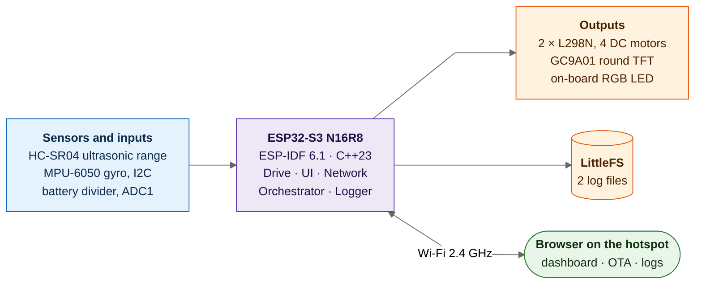
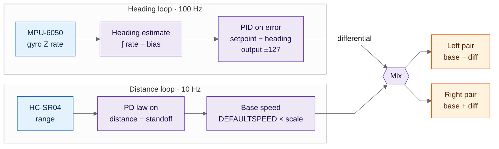
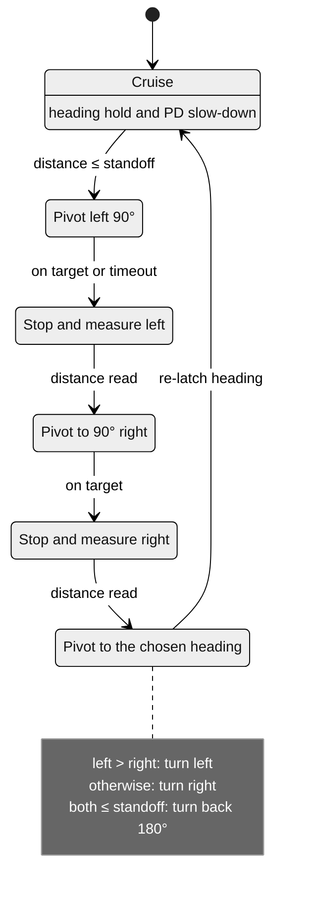
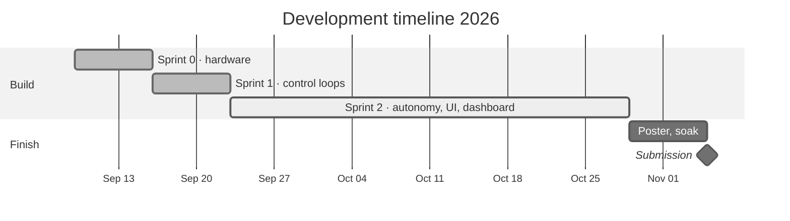
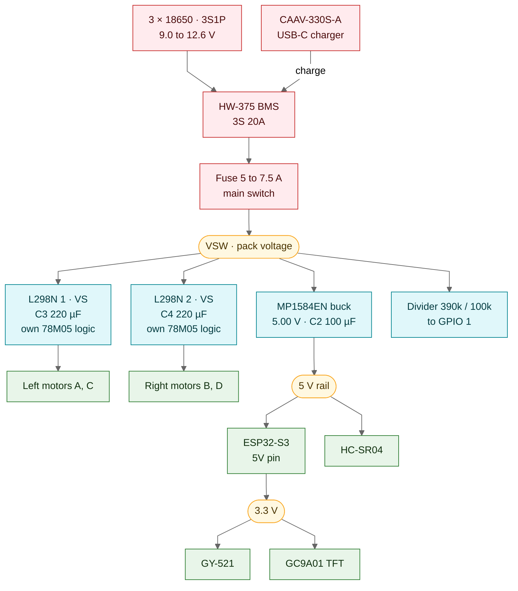
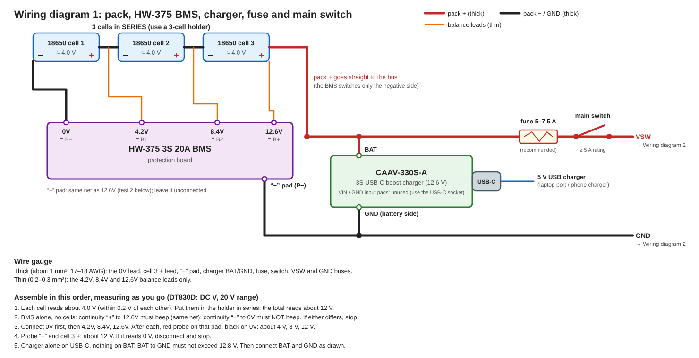
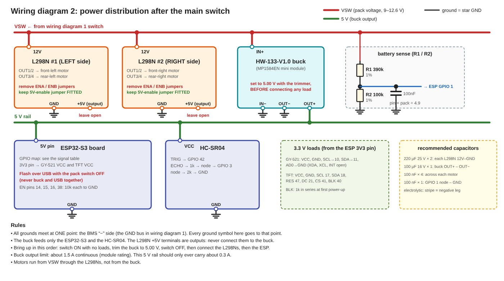

# Software Requirements Specification

Anusmarak — Autonomous Personal Assistant Robot

---

|Field|Detail|
|---|---|
|Document ID|ANUSMARAK-SRS-001|
|Version|1.0.1|
|Status|Updated — hardware bring-up addendum|
|Prepared By|Team Engram|
|Date|October 19, 2026|

---

## Team

|Role|Name|Roll Number|Email|
|---|---|---|---|
|Team Lead|Dhritiman Modak|24155767|24155767@kiit.ac.in|
|POC|Asmit Kumar Jena|24155017|24155017@kiit.ac.in|
|Member A|Aryan Pattanaik|24155759|24155759@kiit.ac.in|
|Member B|Saumil Karn|2405966|24055966@kiit.ac.in|
|Member C|Aman Gupta|2405932|2405932@kiit.ac.in|
|Member D|Harsh Dayma|24052145|24052145@kiit.ac.in|

---

## Table of Contents

1. Introduction
    - 1.1 Purpose
    - 1.2 Scope
    - 1.3 Definitions and Acronyms
    - 1.4 References
    - 1.5 Document Overview
2. Overall Description
    - 2.1 Product Perspective
    - 2.2 Product Functions
    - 2.3 User Characteristics
    - 2.4 Operating Environment
    - 2.5 Design and Implementation Constraints
    - 2.6 Assumptions and Dependencies
3. Specific Requirements
    - 3.1 Functional Requirements
    - 3.2 External Interface Requirements
    - 3.3 Non-Functional Requirements

Appendix A: Hardware Specifications and Budget · Appendix B: GPIO Allocation · Appendix C: Memory Allocation · Appendix D: Development Timeline · Appendix E: Risk Assessment · Appendix F: Electrical Calculations

---

## 1. Introduction

### 1.1 Purpose

This Software Requirements Specification defines the functional requirements, non-functional requirements, external interfaces and design constraints of the Anusmarak autonomous robot. It is the team's reference for design and verification. The firmware source is the final authority: where this document and the code differ, the code is correct and the document is updated to match.

The intended audience is the development team and the course instructor.

### 1.2 Scope

Product Name: Anusmarak (Sanskrit: "one who remembers") Team Name: Engram

Anusmarak is a battery-powered, fully autonomous mobile robot for indoor use. On power-up it cruises forward on a skid-steer platform with no external commands. A 100Hz PID controller on gyroscope yaw rate holds the heading, and a 10Hz PD law on ultrasonic range slows the robot as an obstacle nears. At the standoff distance it runs an escape manoeuvre: it probes left and right and turns toward the clearer side, or turns back if both sides are blocked. A round TFT shows a face with blinking eyes ringed by a battery gauge. A Wi-Fi dashboard shows telemetry and logs and offers over-the-air update and restart. Events are logged to flash.

The system is not a learning system. It does not adapt model weights, infer user intent or modify its behaviour from history. Its memory is strictly event logging to flash; the record of the most recent run stays readable until the next boot.

Voice recognition and audio feedback were designed early in the project and dropped (the hardware was bought and is carried in the budget as sunken cost). They are not part of this system.

### 1.3 Definitions and Acronyms

|Term|Definition|
|---|---|
|ADC|Analog-to-Digital Converter|
|BMS|Battery Management System|
|ESP-IDF|Espressif IoT Development Framework|
|FR|Functional Requirement|
|GPIO|General Purpose Input/Output|
|I2C|Inter-Integrated Circuit|
|IMU|Inertial Measurement Unit|
|ISR|Interrupt Service Routine|
|LEDC|LED Control peripheral (ESP32-S3 PWM engine)|
|LittleFS|Power-loss-resilient flash file system used for logs|
|mDNS|Multicast DNS; lets the robot be reached as `Anusmarak.local`|
|NFR|Non-Functional Requirement|
|OTA|Over-the-air firmware update|
|PD|Proportional-Derivative (control law)|
|PID|Proportional-Integral-Derivative (control law)|
|PSRAM|Pseudo-Static Random Access Memory|
|PWM|Pulse Width Modulation|
|SPI|Serial Peripheral Interface|
|SRS|Software Requirements Specification|
|TFT|Thin-film-transistor colour display (GC9A01, 240×240, round)|
|USD|Ultrasonic distance sensor (HC-SR04)|

### 1.4 References

|Document|Source|
|---|---|
|ESP32-S3 Technical Reference Manual v1.3|Espressif Systems, 2024|
|ESP32-S3-WROOM-1 Datasheet v1.4|Espressif Systems, 2024|
|ESP-IDF Programming Guide v6.1|Espressif Systems, 2026|
|ESP-IDF ADC Oneshot Mode and Calibration Driver Reference|Espressif Systems, 2024|
|esp_littlefs component (joltwallet/littlefs)|IDF Component Registry|
|led_strip component (espressif/led_strip)|IDF Component Registry|
|mdns component (espressif/mdns)|IDF Component Registry|
|MPU-6050 Product Specification Rev 3.4|InvenSense|
|GC9A01 Datasheet|Galaxycore|
|HC-SR04 Datasheet|Various|
|MP1584EN Datasheet|MPS|

### 1.5 Document Overview

Section 2 describes the product in context. Section 3 specifies the requirements in verifiable form, each with an identifier, priority and verification method. Appendices hold the hardware budget (A), GPIO allocation (B), memory allocation (C), development timeline (D) and risk register (E). The Software Design Document (ANUSMARAK-SDD-001) describes how each requirement is implemented.

---

## 2. Overall Description

### 2.1 Product Perspective

Anusmarak is a self-contained system with no dependency on external compute. Control, logging and motor actuation run on the onboard ESP32-S3. The robot joins a Wi-Fi hotspot (the team laptop) as a station so a browser on the same network can open the dashboard. The page loads its chart library and fonts from public CDNs, so the browser (not the robot) needs internet access; the hotspot provides it. No cloud service is needed for operation.

*System context: what the robot senses, drives and talks to.*

### 2.2 Product Functions

- Autonomous Navigation: Cruise forward with PID heading hold on MPU-6050 gyroscope yaw rate at 100Hz; slow down with a 10Hz PD law on HC-SR04 range; at the standoff distance run an escape manoeuvre (probe left, probe right, turn toward the clearer side, or turn back).
- Motor Control: Skid-steer actuation of four DC motors through two L298N dual H-bridge modules with variable-speed PWM.
- Face and Battery Ring: Blinking eyes on a round 240×240 TFT, surrounded by a ring whose colour shows the battery band. The TFT shows no text.
- Battery Monitoring: Filtered battery voltage and percentage from a divider on ADC1; a robot expression (HAPPY, WORRIED, SLEEPY, DEAD) derived from battery, distance and motion.
- Session Logging: Timestamped text records in two LittleFS log files, cleared at the start of every run.
- Wi-Fi Dashboard: Telemetry, USD range chart, log viewer, firmware upload (OTA) and restart.
- Self-Test and Status: Power-on check of every device; an on-board RGB LED shows the result.
- Power Switch: A rocker switch in the pack positive lead switches the robot on and off. There is no software shutdown and no wake input.

### 2.3 User Characteristics

|User Class|Description|Technical Proficiency|
|---|---|---|
|Instructor / Examiner|Evaluates the demonstration and poster|Low to medium — watches the robot and the poster|
|Operator|Development team during the demonstration|High — familiar with all subsystems|
|Observer|Expo attendees|Low — interacts only with the TFT and the dashboard|

### 2.4 Operating Environment

|Parameter|Specification|
|---|---|
|Physical Environment|Indoor; classrooms and expo halls|
|Floor Surface|Smooth, flat: tile, hardwood, or low-pile carpet|
|Lighting Conditions|100–1000 lux|
|Operating Temperature|0°C to 40°C|
|Power Supply|3×18650 Li-ion, 1200mAh each, 11.1V nominal (3S); the motors run from the pack, the logic is buck-converted to 5V|
|Network|Wi-Fi 2.4GHz 802.11 b/g/n; ESP32-S3 station mode on a WPA2 hotspot|

### 2.5 Design and Implementation Constraints

|Constraint|Specification|
|---|---|
|Budget|Total component cost shall not exceed ₹5,000|
|Completion Deadline|Final submission November 5, 2026|
|Microcontroller|ESP32-S3 N16R8 (16MB flash, 8MB PSRAM) on ESP32-S3-WROOM-1 module; chip revision v0.2|
|Firmware Framework|ESP-IDF v6.1.0; C++23|
|Development Methodology|SCRUM-style sprints with completion criteria (Appendix D)|
|Portability|Chassis shall fit within 25×20×15 cm; total mass ≤ 2 kg|
|Battery|3×18650 Li-ion, 1200mAh each, 3S (11.1V nominal, 12.6V full, 9.0V cutoff); protected by HW-375 3S 20A BMS; charged via USB-C boost charger|
|Power Delivery|MP1584EN buck converter steps the 11.1V–12.6V pack to 5V for the ESP32-S3 5V pin and the HC-SR04. The VS pin of both L298N modules is fed directly from the pack (Appendix F.2); the L298N 5V-enable jumper stays fitted, so each module makes its own logic 5V|
|Compute|All control runs on-device; no external API calls|
|Control Architecture|Dual loop on a skid-steer platform. The PID heading-hold loop runs at 100Hz on gyroscope yaw rate. The PD distance loop runs at 10Hz on HC-SR04 readings. Heading hold sets the PWM differential between the left and right pairs; distance control scales the base speed of both pairs. The robot has no external drive input: it decides when and where to move from its own sensors|
|Reserved GPIOs|GPIO 26–32 (flash and PSRAM SPI), 35–37 (octal PSRAM) and 19–20 (USB Serial/JTAG) are never assigned. Strapping pins 0, 45 and 46 are unused|

### Current Hardware Status — Mock Expo (October 29, 2026)

The resistors, capacitors and breadboard are available; the main fuse is not. The team lead has not approved the proposed fuse/copper-wiring work. The 18650 cells are exposed without holders and are soldered together; the interconnect strip appears nickel-plated steel, but this is not confirmed. The switch terminal is a closed loop. The USD failure was traced to the IMU being disconnected; the USD works after the IMU was connected.

These observations supersede the earlier assumption that all hardware and protective parts are in hand. **The battery-powered drive is not cleared for operation while the fuse is missing or power joints are improvised.** BMS protection does not replace a correctly rated fuse. If approved protection and proper terminations cannot be installed and inspected, demonstrate without energizing the pack or motors.

### 2.6 Assumptions and Dependencies

Assumptions:

1. Hardware availability is partial; see “Current Hardware Status — Mock Expo”. A suitable main fuse is not in hand.
2. A laptop providing a 2.4GHz WPA2 hotspot with internet access, and a phone or computer on it, are available at the expo for the dashboard.

Dependencies:

1. ESP-IDF v6.1.0 must provide stable ESP32-S3 support, including PSRAM initialisation. ADC calibration must account for chip revision v0.2 errata via the curve-fitting scheme of the ADC calibration driver.
2. IDF Component Manager packages: `joltwallet/littlefs` ^1.22.3, `espressif/led_strip` ^3.1.0 and `espressif/mdns`.
3. Bootloader app rollback must be enabled (`CONFIG_BOOTLOADER_APP_ROLLBACK_ENABLE`) for safe OTA.

---

## 3. Specific Requirements

### 3.1 Functional Requirements

Priority levels: High — required for a functional demo; Medium — required for the complete demo; Low — implemented if time permits.

---

#### 3.1.1 Autonomous Navigation

*Control structure: the 100Hz heading loop sets the left/right differential, the 10Hz distance loop sets the base speed.*

|ID|Requirement|Priority|Verification|
|---|---|---|---|
|FR-01|When the motors, gyroscope and ultrasonic sensor pass the power-on self-test, the system shall start the drive task and cruise forward without any external command.|High|Robot moves within 15 seconds of power-on with nothing connected|
|FR-02|The system shall read gyroscope Z rate from the MPU-6050 over I2C (address 0x68, ±500°/s, 44Hz low-pass) at 100Hz, average 200 stationary samples at boot as the bias, and integrate the corrected rate into a heading estimate using the measured loop time.|High|Heading estimate responds to chassis rotation; loop rate verified per NFR-02|
|FR-03|The system shall run a PID controller at 100Hz on heading error (setpoint minus estimate). Its output, clamped to ±127 PWM counts, is applied as a differential around the base speed (right pair plus, left pair minus). The integral term shall be clamped. Gains and the clamp are build-time constants. The setpoint is latched to the current heading when cruise starts and after every manoeuvre.|High|Robot holds a straight line; steady-state heading error ≤ 2° per NFR-05|
|FR-04|The system shall measure distance with the HC-SR04 at 10Hz: a 10µs TRIG pulse, with the ECHO pulse width timed by an interrupt pinned to Core 0. Distance is pulse µs ÷ 58 cm, clamped to 400cm; no echo reads as 400cm.|High|Logic analyser on TRIG shows a 10µs pulse every 100ms|
|FR-05|During cruise the system shall scale the base speed by a PD law on (distance − standoff), from 0 to 100% of the default speed, with a minimum PWM floor so the motors do not stall. The standoff (default 20cm) and the gains are build-time constants.|High|Robot visibly slows as an obstacle approaches|
|FR-06|When the measured distance is at or below the standoff, the system shall run an escape manoeuvre: stop; pivot left 90°; stop and measure; pivot to 90° right of the original heading; stop and measure; then pivot toward the side with the larger distance. If both distances are at or below the standoff, it turns back (180° from the original heading). The heading is then re-latched and cruise resumes.|High|Robot turns away from an obstacle placed in its path and carries on|
|FR-07|A pivot shall rotate the robot in place at a fixed escape PWM and end when the heading error is below the turn tolerance (default 2°) or after 3 seconds. A timed-out probe pivot abandons the probe and turns back; a timed-out final pivot ends the manoeuvre where it stopped. A timeout is logged.|High|Pivots complete or time out; a Warn entry is logged on timeout|
|FR-08|When the halt flag is set (FR-24), or when a gyroscope read fails, the system shall de-energise all motor outputs within one control pass (10ms) and report STOP. A gyroscope failure is logged once. When the cause clears, the heading is re-latched and cruise restarts.|High|Motors stop within 100ms of halt per NFR-03; Hardware.log shows the gyroscope warning|
|FR-09|The system shall log each escape (measured distance), the left and right probe distances, each pivot timeout and each gyroscope failure to Hardware.log.|Medium|Entries present after an obstacle is encountered|

*Escape manoeuvre (FR-06, FR-07). Stage numbers and timings are in SDD §4.3.*

---

#### 3.1.2 Motor Control

|ID|Requirement|Priority|Verification|
|---|---|---|---|
|FR-10|The system shall drive four DC motors in a skid-steer configuration through two L298N modules; each side's two motors are ganged. Module 1 (left): Motor A front-left (IN GPIO 2, 4; EN GPIO 14), Motor C rear-left (IN GPIO 5, 6; EN GPIO 15). Module 2 (right): Motor B front-right (IN GPIO 7, 8; EN GPIO 16), Motor D rear-right (IN GPIO 12, 13; EN GPIO 38). Direction is set by the IN pins; a pivot drives the two sides in opposite directions.|High|All four motors respond correctly in cruise and in each pivot direction|
|FR-11|The system shall set motor speed with 8-bit PWM (0–255) at 20kHz on the LEDC peripheral, one channel per motor.|Medium|Speed visibly varies between cruise and slow-down|

---

#### 3.1.3 Display

|ID|Requirement|Priority|Verification|
|---|---|---|---|
|FR-12|The system shall drive the GC9A01 TFT (SPI2, write-only, 40MHz; SCL GPIO 17, SDA GPIO 18, RES GPIO 47, DC GPIO 21, CS GPIO 41, BLK GPIO 40) at a 40Hz refresh pass, rendering in 8-row strips with no frame buffer. The TFT shows no text.|High|Display shows the face and ring after boot|
|FR-13|The face shall be two rectangular eyes that blink (closing for 6 of every 100 passes, about 150ms every 2.5s). The eye region is redrawn only when the eye height changes.|High|Eyes blink at a steady rate|
|FR-14|The battery ring shall be a full circle at radius 110–114 px, coloured by battery band: above 60% green, above 35% yellow, above 15% orange, otherwise red. The screen is redrawn only when the band changes. The backlight comes on only after the first complete frame.|High|Ring colour matches the battery percentage|

---

#### 3.1.4 Battery and Expression

|ID|Requirement|Priority|Verification|
|---|---|---|---|
|FR-15|The system shall read battery voltage from ADC1_CH0 (GPIO 1) through the divider in Section 3.2.2, using the ADC one-shot driver with curve-fitting calibration and an 8-sample average, and compute the percentage linearly: 12.6V = 100%, 9.0V = 0%. ADC2 shall not be used; it is shared with the Wi-Fi radio.|Medium|Percentage agrees with a multimeter reading ±5%|
|FR-16|The system shall sample the battery once per second, including while moving, in a window of 5 samples, and publish a new value only when the window's spread is under 100mV. The published percentage shall only decrease, except that a rise of more than 10 points (recharge) is accepted. Each published change is logged.|Medium|Ring and dashboard percentage do not jump on motor load; a log entry follows each change|
|FR-17|The system shall compute an expression every 100ms with the priority DEAD > SLEEPY > WORRIED > HAPPY. DEAD: the motors, gyroscope or ultrasonic sensor failed self-test. SLEEPY: battery at or below 15%, until above 20%, only if the battery check passed. WORRIED: the robot is not cruising, or the distance is under 30cm, until above 35cm. Otherwise HAPPY. The expression is published on the dashboard; the TFT eyes do not vary with it.|Medium|Dashboard expression follows the stated conditions|

---

#### 3.1.5 Logging

Note: The system logs discrete events to flash. It does not perform model adaptation, weight updates, or any form of incremental learning.

|ID|Requirement|Priority|Verification|
|---|---|---|---|
|FR-18|The system shall mount a LittleFS partition at `/littlefs` at boot, before any subsystem logs. A failed mount ends boot with a console error.|High|Boot completes with logs present|
|FR-19|The system shall write timestamped text records, one line per event, to two files: `Orchestrator.log` (boot, battery, UI and network events) and `Hardware.log` (drive and device events). Each line carries the uptime, a level (Trace, Metrics, Warn, Exception), a source tag and a message, and is flushed to flash as written. Each file is created empty at the start of every run.|High|Both files non-empty after a 5-minute run; no entries from the prior run|
|FR-20|Logging shall never block a calling task: a call formats into a fixed buffer and queues it, and a dedicated task prints and writes. A full queue drops the entry.|High|Control loop timing is unaffected by logging (NFR-02)|

---

#### 3.1.6 Network and Dashboard

|ID|Requirement|Priority|Verification|
|---|---|---|---|
|FR-21|The system shall join a WPA2-PSK hotspot as a station, retry on every disconnect, and advertise the mDNS name `Anusmarak`. Boot waits at most 4 seconds for an address; an unreachable hotspot does not stop the robot.|Medium|Robot reconnects after the hotspot is restarted|
|FR-22|The system shall serve HTTP on port 80: `GET /` (dashboard), `GET /Logs/<name>.log` (log file text) and `GET /Telemetry` (JSON: battery percentage and voltage, chip temperature, expression, RSSI, exception list, uptime in seconds, ultrasonic distance). The dashboard polls telemetry every 2 seconds, charts the last 60 distance samples, shows both logs in tabs, and shows OFFLINE after 4 seconds without telemetry.|Medium|Dashboard loads on a phone on the hotspot and updates|
|FR-23|`POST /OTA` shall write the uploaded image to the inactive OTA slot and, on success, reboot into it. On failure the running image is unchanged and the robot resumes. A new image that does not reach the end of boot shall be rolled back on the next reset.|Medium|A good image boots; an interrupted upload leaves the robot running; a crashing image is rolled back|
|FR-24|`GET /Restart` shall first halt the robot (motors off, display paused, battery sampling paused), wait 100ms and reset the chip. The dashboard asks for confirmation before sending it.|Medium|Motors stop, then the robot restarts|

---

#### 3.1.7 Boot, Self-Test and Autonomy

|ID|Requirement|Priority|Verification|
|---|---|---|---|
|FR-25|At boot the system shall check each device (chip temperature sensor, RGB LED, battery ADC, motors, gyroscope, ultrasonic sensor, TFT, Wi-Fi) and record the result in a failure mask, listed in the boot log line and in telemetry. The on-board RGB LED (GPIO 48) shall show solid green when every check passes and five red blinks otherwise.|High|LED and boot line agree with an injected failure|
|FR-26|If the motors, gyroscope or ultrasonic sensor fail self-test, the system shall not create the drive task and every motor pin shall stay low, so the robot never moves. A failure of any other device shall be logged and shall disable only the feature that uses it.|High|Inject a critical failure: robot does not move; inject a non-critical failure: robot still runs|
|FR-27|The system shall enter autonomous operation on boot completion without user input and sustain it for the whole demonstration without operator intervention.|High|2-hour unattended run completes without crash or watchdog reset|

---

### 3.2 External Interface Requirements

#### 3.2.1 User Interfaces

|ID|Interface|Specification|
|---|---|---|
|UI-01|TFT Display|GC9A01 round colour TFT, 240×240 pixels, SPI; face and battery ring only|
|UI-02|Web Dashboard|HTTP port 80 on the hotspot network; telemetry, log viewer, OTA and restart|
|UI-03|Console|USB Serial/JTAG; log lines mirrored as output only (the robot accepts no serial input)|
|UI-04|RGB LED|On-board WS2812 (GPIO 48); boot self-test result|

#### 3.2.2 Hardware Interfaces

All GPIO assignments are those in Appendix B.

|Interface|GPIO Pins|Protocol|Peripheral|Notes|
|---|---|---|---|---|
|Battery ADC|GPIO 1 (ADC1_CH0)|ADC1|390kΩ/100kΩ voltage divider|Pin = pack ÷ 4.9; maps 9.0V→1.84V, 12.6V→2.57V; 100nF to GND; calculation in Appendix F.3|
|Motor Left Pair — Module 1|IN: GPIO 2, 4 (A), 5, 6 (C); EN: GPIO 14 (A), 15 (C)|GPIO + LEDC|L298N Module 1|Front-left (A) + rear-left (C); VS: pack (F.2)|
|Motor Right Pair — Module 2|IN: GPIO 7, 8 (B), 12, 13 (D); EN: GPIO 16 (B), 38 (D)|GPIO + LEDC|L298N Module 2|Front-right (B) + rear-right (D); VS: pack (F.2)|
|I2C Bus|GPIO 10 (SCL), GPIO 11 (SDA)|I2C @ 400kHz|MPU-6050 (0x68)|Only device on the bus|
|TFT Display|GPIO 17 (SCL), 18 (SDA), 47 (RES), 21 (DC), 41 (CS), 40 (BLK)|SPI2 @ 40MHz, write-only|GC9A01|240×240 round, RGB565; backlight driven by firmware|
|Obstacle Sensor|GPIO 42 (TRIG), GPIO 3 (ECHO)|GPIO (pulse timing)|HC-SR04|TRIG: 10µs pulse; ECHO outputs 5V, divided to 3.3V by a 1kΩ/2kΩ divider (Appendix F.4); timed by a GPIO interrupt on Core 0|
|RGB LED|GPIO 48|RMT (led_strip)|On-board WS2812|Boot status|
|USB|GPIO 19 (D−), GPIO 20 (D+)|USB Serial/JTAG|USB-C|Flashing and log console; reserved|
|Flash and PSRAM (internal)|GPIO 26–32, GPIO 35–37|—|Flash SPI; N16R8 octal PSRAM|Reserved; not available|

Point-to-point wiring is in SDD §6.4.

#### 3.2.3 Communication Interfaces

|Protocol|Configuration|Purpose|
|---|---|---|
|Wi-Fi 802.11 b/g/n|Station mode; joins a WPA2-PSK hotspot; mDNS|Dashboard, log access, OTA|
|USB 2.0|USB-C; USB Serial/JTAG (CDC-ACM)|Firmware flashing and log console|

---

### 3.3 Non-Functional Requirements

The targets below are design targets. A target that has not been measured is not claimed as verified.

#### 3.3.1 Performance

|ID|Requirement|Target|Verification Method|
|---|---|---|---|
|NFR-01|Escape response (obstacle at or below standoff → pivot begins)|≤ 200ms|Logic analyser on motor GPIO after ECHO falls|
|NFR-02|Heading-hold loop execution rate|100Hz (10ms period)|`esp_timer_get_time()` on loop entry over 1000 consecutive cycles|
|NFR-03|Halt response (halt requested → motor outputs off)|≤ 100ms|Logic analyser on motor GPIO|
|NFR-04|Log write latency (one line, ≤ 128 bytes, including flush)|≤ 50ms|`esp_timer_get_time()` around the write in the log task|
|NFR-05|Heading-hold steady-state error (clear 2-metre cruise)|≤ 2°|Heading read at the end of the run|
|NFR-06|Boot time (power-on → autonomous operation)|≤ 15 seconds|Stopwatch from power-on to first TFT frame|

#### 3.3.2 Reliability

|ID|Requirement|Verification Method|
|---|---|---|
|NFR-07|The system shall operate continuously for at least 2 hours on battery. Basis (Appendix F.2): 5.08W at the pack (1.20W on the 5V rail through the buck at 0.92 efficiency, 0.44W in the L298N logic regulators, and the four motors from the pack at 50% duty and 150mA average each while driven), rated pack energy 3 × 1.2Ah × 3.7V = 13.32Wh, giving 2.62 hours. This holds while the average current per motor while driven stays at or below 221mA (rated cells) or 161mA (cells at 80% of rated capacity). The 150mA used is a no-load figure and has not been measured.|2-hour unattended run at full operational load|
|NFR-08|The log files shall remain readable after 10 consecutive unclean power-offs.|Pull power mid-write; before the next boot read the LittleFS partition image and verify intact lines; repeat 10 times|
|NFR-09|A firmware image that fails to reach the end of boot shall not strand the robot: the bootloader shall return to the previous image on the next reset.|Flash an image that crashes at start-up; robot returns to the previous image|

#### 3.3.3 Security

|ID|Requirement|
|---|---|
|NFR-10|The Wi-Fi station shall join WPA2-PSK networks only.|
|NFR-11|The HTTP interface exposes restart and OTA without authentication. This is a deliberate decision: the robot runs only on a private exhibition hotspot. The risk is accepted (Appendix E).|

#### 3.3.4 Portability

|ID|Requirement|Verification Method|
|---|---|---|
|NFR-12|Assembled chassis shall not exceed 25cm × 20cm × 15cm.|Physical measurement|
|NFR-13|Total assembled mass shall not exceed 2kg.|Digital scale|
|NFR-14|The system shall be self-powered with no external cables during the demonstration.|Visual inspection during the 2-hour run|

#### 3.3.5 Environmental

|ID|Requirement|Verification Method|
|---|---|---|
|NFR-15|The system shall operate correctly under 100–1000 lux indoor lighting.|Visual confirmation of face and ring visibility and sensor function at three lighting levels|
|NFR-16|Motor noise shall not exceed 70 dB(A) at 1 metre from the chassis.|Smartphone sound level meter (±5 dB indicative)|

---

## Appendix A: Hardware Specifications and Budget

| Component         | Model                                | Qty | Unit (₹) | Total (₹) | Status           |
| ----------------- | ------------------------------------ | --- | -------- | --------- | ---------------- |
| Microcontroller   | ESP32-S3-WROOM-1-N16R8               | 1   | 999      | 999       | ✅ Ordered        |
| Chassis + Motors  | 4WD platform with TT motors (3–6V)   | 1   | 539      | 539       | ✅ Purchased      |
| Motor Driver      | L298N dual H-bridge (Module 1)       | 1   | 199      | 199       | ✅ Ordered        |
| Motor Driver      | L298N dual H-bridge (Module 2)       | 1   | 199      | 199       | ✅ Ordered        |
| TFT Display       | GC9A01 round 240×240 SPI             | 1   | 826      | 826       | ✅ Ordered        |
| IMU               | MPU-6050 breakout                    | 1   | 289      | 289       | ✅ Ordered        |
| Audio I/O Module  | MAX98357A + INMP441 combo            | 1   | 439      | 439       | **Sunken Cost**  |
| Speaker           | 4Ω 3W (pack of 2)                    | 1   | 256      | 256       | **Sunken Cost**  |
| Ultrasonic Sensor | HC-SR04                              | 1   | 150      | 150       | ✅ Ordered        |
| Resistors         | 390kΩ, 1% metal film, ¼W             | 2   | 5        | 10        | **Local Market** |
| Resistors         | 100kΩ, 1% metal film, ¼W             | 2   | 5        | 10        | **Local Market** |
| Resistors         | 1kΩ, 1% metal film, ¼W               | 2   | 5        | 10        | **Local Market** |
| Resistors         | 2kΩ, 1% metal film, ¼W               | 2   | 5        | 10        | **Local Market** |
| Resistors         | 10kΩ, 5%, ¼W                         | 6   | 5        | 30        | **Local Market** |
| Resistors         | 4.7kΩ, 5%, ¼W                        | 3   | 5        | 15        | **Local Market** |
| Capacitors        | 100nF ceramic                        | 8   | 5        | 40        | **Local Market** |
| Capacitors        | 100µF, ≥16V electrolytic             | 2   | 5        | 10        | **Local Market** |
| Capacitors        | 220µF, ≥25V electrolytic             | 3   | 5        | 15        | **Local Market** |
| Test Equipment    | Digital multimeter                   | 1   | 400      | 400       | **Local Market** |
| Battery Cells     | 18650 Li-ion 1200mAh (×3)            | 3   | 40       | 120       | ✅ Ordered        |
| Battery Charger   | USB-C to 12.6V 3S Boost Charger      | 1   | 175      | 175       | ✅ Ordered        |
| Protection BMS    | HW-375 3S 20A BMS                    | 1   | 69       | 69        | ✅ Ordered        |
| Buck Converter    | MP1584EN 3A DC-DC Step-Down          | 1   | 123      | 123       | ✅ Ordered        |
| Fuse              | 5A fuse with holder (blade or glass) | 1   | 20       | 20        | **Not Sourced**  |
| Total             |                                      |     |          | ₹4,953    |                  |
| Budget Ceiling    |                                      |     |          | ₹5,000    |                  |
| Headroom          |                                      |     |          | ₹47       |                  |

Sunken Cost items were purchased for the dropped audio feature and are not used; they stay in the total because the money is spent. Resistor roles are in Appendix F.5 and their ratings in Appendix F.6; capacitor roles and ratings are in Appendix F.7; every resistor and capacitor is priced at ₹5. Resistor and capacitor quantities are purchase quantities and include spares (the design needs 1 × 390kΩ, 1 × 100kΩ, 1 × 1kΩ, 1 × 2kΩ, 4 × 10kΩ, 2 × 4.7kΩ, 5 × 100nF, 1 × 100µF and 2 × 220µF); the second 1kΩ is a spare. The multimeter is a bench tool for the checks in Appendix F.8; its ₹400 price is an estimate, and the budget ceiling is exceeded if it costs more than ₹462.

---

## Appendix B: GPIO Allocation

Complete pin assignment for the ESP32-S3-WROOM-1-N16R8, taken from the firmware configuration. SDD §6.2 is the master copy of this table.

|**GPIO**|**Function**|**Subsystem**|**Notes**|
|---|---|---|---|
|**0**|Boot-mode strapping|System|Unused; do not connect|
|**1**|Battery sense (ADC1_CH0)|Battery|390kΩ/100kΩ divider, 100nF to GND|
|**2**|Motor A IN1|Motors (left)|Front-left direction|
|**3**|HC-SR04 ECHO|Ultrasonic|JTAG-source strapping pin, read only if its eFuse is set; 5V ECHO divided to 3.3V by 1kΩ/2kΩ; any-edge ISR on Core 0|
|**4**|Motor A IN2|Motors (left)|Front-left direction|
|**5**|Motor C IN1|Motors (left)|Rear-left direction|
|**6**|Motor C IN2|Motors (left)|Rear-left direction|
|**7**|Motor B IN1|Motors (right)|Front-right direction|
|**8**|Motor B IN2|Motors (right)|Front-right direction|
|**9**|Spare|—|Unassigned|
|**10**|I2C SCL|MPU-6050|400kHz|
|**11**|I2C SDA|MPU-6050|Only device on the bus|
|**12**|Motor D IN1|Motors (right)|Rear-right direction|
|**13**|Motor D IN2|Motors (right)|Rear-right direction|
|**14**|Motor A EN (LEDC CH0)|Motors (left)|8-bit PWM; 10kΩ pull-down to GND recommended (F.5)|
|**15**|Motor C EN (LEDC CH1)|Motors (left)|8-bit PWM; 10kΩ pull-down to GND recommended (F.5)|
|**16**|Motor B EN (LEDC CH2)|Motors (right)|8-bit PWM; 10kΩ pull-down to GND recommended (F.5)|
|**17**|TFT SCL|GC9A01|SPI2 clock|
|**18**|TFT SDA|GC9A01|SPI2 data|
|**19**|USB D−|Console|Reserved: USB Serial/JTAG|
|**20**|USB D+|Console|Reserved: USB Serial/JTAG|
|**21**|TFT DC|GC9A01|Data/command select|
|**22–25**|Not present|—|—|
|**26–32**|Flash / PSRAM SPI (internal)|—|Reserved; do not connect|
|**33–34**|Not exposed|—|—|
|**35–37**|Octal PSRAM (internal)|—|Reserved; unusable on N16R8|
|**38**|Motor D EN (LEDC CH3)|Motors (right)|8-bit PWM; 10kΩ pull-down to GND recommended (F.5)|
|**39**|Spare|—|Unassigned|
|**40**|TFT BLK|GC9A01|Backlight, firmware-driven|
|**41**|TFT CS|GC9A01|Chip select|
|**42**|HC-SR04 TRIG|Ultrasonic|10µs pulse at 10Hz|
|**43**|Spare (UART0 TX default)|—|Unassigned; console is USB|
|**44**|Spare (UART0 RX default)|—|Unassigned; console is USB|
|**45**|VDD_SPI strapping|—|Unused; avoid|
|**46**|Boot strapping|—|Unused; do not connect|
|**47**|TFT RES|GC9A01|Hardware reset|
|**48**|On-board RGB LED (WS2812)|Status|Hardwired on-board|

---

## Appendix C: Memory Allocation

### PSRAM (8MB, Octal, 80MHz)

Enabled in the build and initialised at boot, but the firmware allocates nothing from it. No buffer larger than a few KB exists anywhere in the firmware, and the display has no frame buffer. The whole 8MB is unused reserve.

### Internal SRAM (512KB)

|Allocation|Size|Notes|
|---|---|---|
|Task stacks (Drive, UI, Log, Orchestrator)|16,384 B|4 × 4,096 B; provisional until measured|
|Log queue storage|1,408 B|16 entries × 88 B|
|TFT strip buffer|3,840 B|240 × 8 rows × 2 B|
|Handles, atomics, small buffers|≈ 300 B||
|Firmware-owned total|≈ 22KB||
|Wi-Fi stack, HTTP server, drivers|IDF-managed|Not budgeted here|

### Flash (16MB, Partition Table Covers the First 8MB)

|Partition|Offset|Size|Contents|
|---|---|---|---|
|nvs|0x9000|20KB|Wi-Fi driver key-value store|
|otadata|0xE000|8KB|Active OTA slot record|
|ota_0|0x10000|2MB|Firmware slot 0|
|ota_1|0x210000|2MB|Firmware slot 1|
|littlefs|0x410000|3.875MB|Log files|
|coredump|0x7F0000|64KB|Panic core dump|
|(unmapped)|0x800000|8MB|Unused|

---

## Appendix D: Development Timeline

|Sprint|Dates|Focus|Completion Criteria|
|---|---|---|---|
|Sprint 0|Sep 9–15|Hardware bring-up|All components verified; motors run; LittleFS mounts; HC-SR04 returns valid readings; GPIO allocation checked with a multimeter; buck output 5V ±0.1V|
|Sprint 1|Sep 16–22|Control loops|Robot holds a straight line within 2°; speed scales down on approach to an obstacle|
|Sprint 2|Sep 23–Oct 28|Autonomy, display, dashboard, integration|Autonomous cruise and escape; face and ring on the TFT; dashboard, OTA and logs working; 30-minute autonomous run without crash|
|Preparation|Oct 29–Nov 4|Poster, presentation, soak|Poster and physical presentation ready; 2-hour unattended run completes; log files consistent|
|Submission|Nov 5|Final submission|Submitted|

*Sprint timeline (Appendix D table above).*

---

## Appendix E: Risk Assessment

### Risk Register

|ID|Risk|Probability|Impact|
|---|---|---|---|
|R-01|Heading-hold PID oscillates due to gyroscope noise or aggressive Kd|Medium|Medium|
|R-02|HC-SR04 reading jitter causes speed hunting or a false escape|Low|Medium|
|R-03|Pivots overshoot or hunt on tile: motor coast, provisional PWM values, 2° tolerance|Medium|Medium|
|R-04|LittleFS log files corrupted by an unclean power cycle during a write|Low|Medium|
|R-05|Battery runtime falls below 2 hours under full load|Low|Medium|
|R-06|Hotspot lost, or without internet, at the venue; the dashboard stops updating|Medium|Low|
|R-07|ECHO ISR latency or a flash-write stall distorts the distance measurement or the loop timing|Low|Medium|
|R-08|ADC noise or v0.2 errata distorts the battery reading; load sag keeps the stable window from forming and freezes the percentage|Low|Low|
|R-09|Buck converter output unstable under Wi-Fi bursts|Low|High|
|R-10|HC-SR04 5V ECHO applied directly to GPIO 3 damages the ESP32-S3|Low|High|
|R-11|Gyroscope bias or I2C start-up failure disables autonomy (Drive refuses to start)|Low|High|
|R-12|A bad or interrupted OTA image|Low|Medium|
|R-13|Unauthenticated restart and OTA endpoints are misused|Low|Low|
|R-14|ESP32-S3 PSRAM instability (chip revision v0.2) at boot|Low|High|
|R-15|A short in the pack wiring heats or burns a wire or damages a cell|Low|High|

### Mitigation and Contingency

|Risk|Mitigation|Trigger|Contingency|
|---|---|---|---|
|R-01|Tune Kp first with Ki = Kd = 0; add Kd incrementally; test on a 2-metre straight run|Oscillation observed|Reduce Kp by 50%; remove the I term|
|R-02|Ping at a fixed 10Hz; hysteresis comes from the escape state machine|Speed hunting at a fixed obstacle|Increase Kd; low-pass the derivative term|
|R-03|Settle and re-measure between pivots; 3-second pivot timeout; PWM values tuned on tile|Pivot ends more than ±10° from target, or times out|Raise the escape PWM; widen the turn tolerance|
|R-04|Every line is flushed as written; LittleFS is power-loss resilient|Corruption detected after a power cycle|Reformat the partition and re-provision the Logs directory|
|R-05|Measure actual current draw with a multimeter in series at the BMS output|Measured pack draw > 5.3W at full load (about 0.48A at 11.1V)|Reduce the default speed; keep a USB-C cable at the stand|
|R-06|Set the hotspot to 2.4GHz WPA2 with internet and test it at the venue; the robot retries on every disconnect|Dashboard unreachable or script not running|Restart the hotspot; the face, ring and robot behaviour are unaffected|
|R-07|Pin the ISR and the drive task to Core 0; the loop integrates with measured loop time, not a fixed period|Distance readings deviate > 5cm from reference|Reduce the ping rate to 5Hz|
|R-08|Curve-fitting calibration; 100nF cap on GPIO 1; 8-sample average; stable-window filter|Readings show > 200mV noise, or the percentage stops moving under load|Use a longer average; log voltage during motion|
|R-09|Check the 5V output under Wi-Fi bursts; fit C2 (100µF) on the buck output (F.7). The motors are on the pack rail (C3, C4), so the buck no longer sees motor inrush|Buck output drops below 4.75V under load|Add a second bulk capacitor on the buck output|
|R-10|1kΩ/2kΩ divider on ECHO; check GPIO 3 with a multimeter before powering the MCU|GPIO 3 reads > 3.6V (the normal reading is 3.17–3.50V, F.4)|Replace the sensor with a 3.3V-compatible module (HC-SR04P)|
|R-11|Keep the robot stationary at power-on (about 2 seconds for bias sampling); the self-test reports the cause|Boot line lists IMU or USD|Re-seat the wiring and reboot|
|R-12|Rollback is enabled; the image is marked valid only at the end of boot; a halted robot stays safe during upload|Robot does not return after OTA|Reflash over USB|
|R-13|The network is a private exhibition hotspot (accepted)|Unexpected restart or upload|Change the hotspot password|
|R-14|Test cold and warm boots; the firmware does not use PSRAM|Boot aborts at PSRAM initialisation|Disable PSRAM in the build configuration|
|R-15|Cell leads to the BMS are short and insulated, and cells are connected last. The BMS has short-circuit protection on its output side (HW-375 trip point not verified). A correctly rated fuse in a suitable holder in the pack-positive lead is required before battery-powered operation; the fuse is currently unavailable|Sparks, a hot wire or a hot cell at any connection|Disconnect the cells at once; do not reconnect until the cause is found; do not energize the pack or run the motors without an installed, correctly rated fuse|

---

## Appendix F: Electrical Calculations

All figures are design calculations. Nothing here has been measured on the robot; assumed values are labelled as such.

### F.1 Power Chain

Pack (3S1P, 9.0–12.6V, 11.1V nominal, HW-375 BMS) → MP1584EN buck (input 4.5–28V, set to 5.0V) → 5V rail. The pack also feeds the VS pin of both L298N modules directly (F.2).

|Consumer|Supplied from|
|---|---|
|ESP32-S3 board 5V pin (its regulator makes 3.3V for the TFT, MPU-6050 and any I2C pull-ups)|5V rail|
|HC-SR04|5V rail|
|L298N motor supply (VS), both modules|Pack, after the BMS output (decision in F.2)|
|L298N logic 5V|Each module's on-board regulator, fed from VS with the 5V-enable jumper fitted; the +5V terminal is an output and is not connected to the buck|

*Power tree. Wiring diagrams are in SDD §6.4.*

### F.2 Power Budget and Runtime

The motors run from the pack, so the buck's 5V rail carries only the logic-side loads. A linear regulator passes the 3.3V load current through unchanged, so every load below is counted as current at 5V.

|Load|Basis|5V current|Power|
|---|---|---|---|
|ESP32-S3 module and board regulator|ESP32-S3 datasheet, modem-sleep at 240MHz with both cores busy: 92–108mA at 3.3V; Wi-Fi RX 95mA; TX peaks 286–355mA at low duty; plus board overhead|160mA|0.80W|
|TFT with backlight|Assumed; the module has no datasheet figure|60mA|0.30W|
|MPU-6050 breakout|Assumed (about 4mA plus board)|5mA|0.025W|
|HC-SR04|Typical 15mA|15mA|0.075W|
|**Rail total**||240mA|**1.20W**|

Loads on the pack:

- The 5V rail: 1.20W ÷ 0.92 (buck efficiency) = 1.30W.
- L298N logic, 2 modules: the on-board linear 78M05 of each module runs from VS. L298 datasheet I_SS 7–24mA typical per IC with EN high, plus board LEDs, gives 40mA; 40mA × 11.1V = 0.44W.
- Motors, 4×: assumed 150mA average each while driven (TT-motor no-load current at 3V), at 50% duty (`DEFAULTSPEED` 128): 4 × 0.5 × 11.1V × I_m = 22.2W × I_m, where I_m is the average current per motor while it is driven.

Pack energy E = 3 × 1.2Ah × 3.7V = 13.32Wh (rated). Pack power = 1.30W + 0.44W + 22.2W × I_m = 1.75W + 22.2W × I_m. At I_m = 0.15A this is 5.08W. **Runtime = 13.32 ÷ 5.08 = 2.62 hours.**

General form: runtime = E ÷ (1.75W + 22.2W × I_m).

|I_m per motor|Pack power|Runtime, rated cells|Runtime, cells at 80% of rated|
|---|---|---|---|
|0.15A|5.08W|2.62h|2.10h|
|0.20A|6.19W|2.15h|1.72h|
|0.25A|7.30W|1.83h|1.46h|
|0.30A|8.41W|1.58h|1.27h|

The 2-hour requirement holds while I_m ≤ 221mA (rated cells, pack power ≤ 6.66W) or ≤ 161mA (cells at 80%, pack power ≤ 5.33W). The 150mA used is a no-load figure; a loaded 4WD chassis on tile draws more. Motor current has not been measured, so NFR-07 is a design target.

**Decision: L298N supply (VS).** VS is fed from the pack, after the BMS output. The constants `DEFAULTSPEED` 128 and `MINPWM` 90 are 50% and 35% duty. After the L298N's drop of about 1.8V, the average motor voltage is:

|VS|PWM 128|PWM 90|
|---|---|---|
|5V rail|1.6V|1.1V|
|Pack (11.1V)|4.7V|3.3V|

TT motors are rated 3–6V. At 1.1–1.6V they would stall or crawl, so the constants fit a pack-fed VS. On a 5V rail the buck would also have to supply about 1.3A in cruise, 2.3A in a pivot at 0.5A per motor and 3.5A with all four stalled at 0.8A, which is above the MP1584EN's 3A limit. With the pack-fed VS, at PWM 255 and 12.6V the peak is about 10.8V, above the motor rating; `DEFAULTSPEED` plus the PID clamp (128 + 127) reaches 255, so this occurs only briefly during large heading corrections. Watch for a motor running hot.

### F.3 Battery Divider (GPIO 1)

R1 = 390kΩ (pack positive to GPIO 1), R2 = 100kΩ (GPIO 1 to GND). Pin voltage = pack × R2 ÷ (R1 + R2) = pack ÷ 4.9. Firmware: `BATNUM` ÷ `BATDEN` = 49 ÷ 10 = 4.9.

|Pack|9.0V (0%)|10.5V|11.1V|12.6V (100%)|
|---|---|---|---|---|
|Pin|1.837V|2.143V|2.265V|2.571V|

- Range: ADC1 at 12dB (`ADC_ATTEN_DB_12`) measures 0–3100mV on the ESP32-S3 (ESP-IDF 4.4 documentation; re-check against 6.1). The largest pack voltage that fits is 3.1 × 4.9 = 15.19V, which is 20.6% above 12.6V. The 0–3.3V range quoted earlier is the pin limit, not the ADC range at this attenuation.
- Resolution: 3100 ÷ 4095 = 0.757mV per count at the pin = 3.7mV at the pack. One percent is 36mV, or about 9.7 counts.
- Source impedance and filter: R1 ∥ R2 = 79.6kΩ. With the 100nF capacitor, τ = 79.6kΩ × 100nF = 7.96ms and the corner is 20Hz. The 20kHz motor PWM is attenuated by a factor of 1000 (−60dB).
- Divider current: 12.6V ÷ 490kΩ = 25.7µA (0.32mW). Each 100nA of ADC input leakage shifts the pin by 100nA × 79.6kΩ = 8mV, which is 39mV at the pack.
- Tolerance (worst case, R1 high and R2 low, or the reverse):

|Resistors|Ratio error|Reads at a true 12.6V|Percentage error|
|---|---|---|---|
|1%|−1.6% / +1.6%|12.40–12.80V|±5.6 points|
|5%|−7.7% / +8.2%|11.63–13.63V|±29 points|

The BOM does not state a tolerance. Local carbon-film resistors are normally 5%, which would put the percentage and the ring colour far off. Measure the two resistors with a multimeter and set `BATNUM` ÷ `BATDEN` to the measured (R1 + R2) ÷ R2.

- Protection: the pin exceeds its 3.6V limit only if the pack exceeds 17.6V. If R2 opens, the pin clamps through the ESD diode at (12.6 − 3.6) ÷ 390kΩ = 23µA.

### F.4 HC-SR04 ECHO Divider (GPIO 3)

R3 = 1kΩ (ECHO to GPIO 3), R4 = 2kΩ (GPIO 3 to GND). Pin voltage = VCC × 2 ÷ (1 + 2).

|HC-SR04 VCC|4.75V|5.00V|5.25V|
|---|---|---|---|
|GPIO 3|3.17V|3.33V|3.50V|

- Logic high: the ESP32-S3 input threshold is 0.75 × 3.3V = 2.475V (DC characteristics), so VCC must exceed 3.71V. The pin limit is VDD + 0.3V = 3.6V, so VCC must stay below 5.4V. Margin at 5.25V is 0.1V.
- The firmware's internal pull-down (about 45kΩ) lowers the 5.00V case to 3.28V.
- Load on the sensor: 5V ÷ 3kΩ = 1.67mA.
- Speed: R3 ∥ R4 = 667Ω with about 20pF gives τ = 13ns. The timing resolution is 58µs per centimetre, so the divider adds no measurable error.
- Tolerance: with 1% resistors the pin stays between 3.15V and 3.52V over VCC 4.75–5.25V. With 5% resistors it can reach 3.62V at VCC 5.25V, above the 3.6V limit. R3 and R4 are therefore specified at 1% (F.6).
- TRIG (GPIO 42) drives the sensor directly at 3.3V; no resistor is fitted (assumed to be above the sensor's input threshold of about 2V).

### F.5 Other Resistors and Board Checks

All resistors in the design:

|Ref|Value|Where|Purpose|Status|
|---|---|---|---|---|
|R1|390kΩ|Pack positive to GPIO 1|Battery divider, top|In BOM|
|R2|100kΩ|GPIO 1 to GND|Battery divider, bottom|In BOM|
|R3|1kΩ|HC-SR04 ECHO to GPIO 3|ECHO divider, top|In BOM|
|R4|2kΩ|GPIO 3 to GND|ECHO divider, bottom|In BOM|
|R5–R8|10kΩ|GPIO 14, 15, 16 and 38 to GND, at the L298N EN pins|Hold the drivers off while the pins float at reset and boot|In BOM|
|R9, R10|4.7kΩ|MPU-6050 SDA and SCL to 3.3V|I2C pull-ups|In BOM; fit only if the GY-521 has none (measure SDA to 3.3V)|

- R5–R8: from reset until `Drive::Initialize()` sets them low (mount, hardware and NVS set-up come first), the GPIOs are inputs with no pull. A floating EN with a floating IN can briefly drive a motor. L298 enable inputs leak about 10µA at low level and read low below about 1.5V (verify in the datasheet), so the largest usable pull-down is about 150kΩ; 10kΩ leaves a 15× margin and draws 0.33mA when the pin is high.
- R9, R10: the firmware enables only the internal pull-ups, about 45kΩ. Rise time t_r = 0.8473 × R × C_bus. With 45kΩ and 50pF it is 1.9µs, which fails the 300ns limit of 400kHz operation (and 1000ns at 100kHz). With 4.7kΩ it is 199ns at 50pF and 398ns at 100pF. The largest pull-up that meets 300ns is 7.1kΩ at 50pF and 3.5kΩ at 100pF. Many GY-521 breakouts carry 4.7kΩ pull-ups; confirm by measuring SDA to 3.3V.
- TFT backlight (GPIO 40): GPIO 40 drives BLK directly and no series resistor is fitted. Measured with a multimeter on the bench: BLK reads open in diode mode against both GND and VCC in both directions, and the current into BLK with the backlight lit is 0.40mA, so BLK is a high-impedance input (gate or base) and far below the 20mA limit of an ESP32-S3 pin. If the backlight is on before the first frame or off after it, the polarity is inverted: correct it in firmware.

Wiring checks that are not resistors:

- Remove the ENA and ENB jumpers on both L298N modules. With the jumpers fitted the EN pins sit at 5V and the PWM GPIOs would be driven into 5V.
- Leave the L298N 5V-enable jumper fitted on both modules. VS is pack-fed, so the on-board regulator works and the +5V terminal is an output; do not connect it to the buck.
- Set the buck to 5.0V before connecting the ESP32-S3, and fit C2 (F.7) on its output.
- Precaution: never power the ESP32-S3 from the buck 5V and from USB-C at the same time. Run from the pack with USB-C unplugged, or flash over USB-C with the buck output disconnected from the 5V pin.

### F.6 Resistor Ratings

All resistors are through-hole axial, ¼W (0.25W). Every resistor dissipates under 7mW, so ¼W leaves a margin of more than 35×; a ⅛W part would also do.

|Ref|Value|Tolerance and type|Dissipation (worst case)|Why this tolerance|
|---|---|---|---|---|
|R1|390kΩ|1%, metal film|0.26mW at a 12.6V pack|The battery ratio error is ±1.6% at 1% and ±8% at 5% (F.3)|
|R2|100kΩ|1%, metal film|0.07mW|As R1|
|R3|1kΩ|1%, metal film|3.1mW at VCC 5.25V|At 5% the GPIO 3 voltage can reach 3.62V, above the 3.6V pin limit (F.4)|
|R4|2kΩ|1%, metal film|6.1mW at VCC 5.25V|As R3|
|R5–R8|10kΩ|5%, carbon or metal film|1.1mW with the pin high|Value is not critical; anything from about 4.7kΩ to 47kΩ works|
|R9, R10|4.7kΩ|5%, carbon or metal film|2.3mW with the line low|Value is not critical below 7kΩ (F.5)|

R1 and R2 see at most 10V, far below the voltage rating of any ¼W resistor. Buy R1–R4 as 1% metal film and check each with a multimeter before fitting.

### F.7 Capacitors

|Ref|Value and type|Where|Purpose|Status|
|---|---|---|---|---|
|C1|100nF ceramic|GPIO 1 to GND|Battery divider filter (F.3)|In BOM|
|C2|100µF electrolytic, ≥10V (16V in BOM)|Buck OUT+ to OUT−|Wi-Fi burst load on the 5V rail (R-09)|In BOM|
|C3, C4|220µF electrolytic, ≥25V|Each L298N +12V (VS) terminal to GND|Motor inrush and H-bridge switching on the pack rail|In BOM|
|C5–C8|100nF ceramic|Across each motor's two terminals, soldered on the motor tabs|Brush noise; it can corrupt the 400kHz I2C gyro reads and the ADC, and a failed gyro read stops the robot (FR-08)|In BOM|

- C3 and C4 are rated ≥25V because the pack reaches 12.6V; a 16V part leaves too little margin.
- Observe polarity on all electrolytic capacitors (C2, C3, C4).
- Many MP1584EN and L298N modules already carry on-board capacitors; check them, but C2, C3 and C4 are still fitted.

### F.8 Expected Measurements

*Wiring diagram 1: pack, BMS, charger, fuse and main switch. Pad names follow the standard low-side layout; confirm each pad with the checks below before connecting.*

*Wiring diagram 2: power distribution after the main switch. Signal wiring is in SDD §6.4.*

Bench checks with a multimeter, in the order to do them. Power off for every "before first power" check. Nothing here has been measured yet; these are the values to expect.

|Stage|Check|Expected|If not|
|---|---|---|---|
|Before soldering|1% resistors, out of circuit|390kΩ: 386–394kΩ; 100kΩ: 99–101kΩ; 1kΩ: 990–1010Ω; 2kΩ: 1.98–2.02kΩ|Use another part. Set `BATNUM` ÷ `BATDEN` to the measured (R1 + R2) ÷ R2 (F.3)|
|Before soldering|5% resistors, out of circuit|10kΩ: 9.5–10.5kΩ; 4.7kΩ: 4.47–4.94kΩ|Use another part|
|Before soldering|Each 18650|3.6–4.2V, all close to each other|Charge or match the cells first|
|Before soldering|GY-521 SDA to VCC, module unpowered|7kΩ or less: it has pull-ups, so leave R9 and R10 off. Open circuit, or 10kΩ and above: fit R9 and R10|See F.5|
|While soldering the BMS (0V, 4.2V, 8.4V, 12.6V in order)|Each pad against 0V|4.2V pad: one cell (about 3.7V); 8.4V pad: about 7.4V; 12.6V pad: about 11.1V|Stop and find the wrong wire before the next pad|
|Before first power|BMS output + to −|Pack voltage (9.0–12.6V). If it reads 0V, briefly connect the charger|Check the cell wiring|
|Before first power|Pack+ to GND, and each L298N VS to GND|No short. A rising reading is the capacitors charging|Find the short before connecting power|
|Before first power|Every GND point to pack negative|About 0Ω|Fix the common ground|
|Before first power|GPIO 3, with 5V from the buck applied to the top of R3 and R4 to GND|3.33V; anything from 3.17 to 3.50V is acceptable. The limit is 3.6V|Check R3 and R4 (1kΩ and 2kΩ)|
|First power, no ESP32 connected|Buck output|5.00V ±0.05V (Sprint 0 accepts ±0.1V)|Adjust the trimmer before connecting the ESP32|
|First power|L298N VS|Pack voltage|Check the wiring from the BMS output|
|First power|L298N +5V terminal, jumper fitted|About 5V; it is an output, leave it unconnected|Check that the 5V-enable jumper is fitted|
|First power|ESP32-S3 3V3 pin|3.2–3.4V|Check the 5V feed|
|First power|ESP32 5V pin|5.0V; never also on USB-C (F.5)|Disconnect one of the two sources|
|Running|GPIO 1 at a full pack, 11.1V and 9.0V|2.57V, 2.27V and 1.84V (±1.6% with 1% resistors)|Recheck R1 and R2|
|Running|Dashboard voltage against the multimeter, at about 12.0V and 12.6V|Within 1–2%; the percentage within ±5 points (FR-15). A reading that stops rising near full charge means the ADC range is lower than assumed (F.3)|Recheck the divider, then the `BATNUM` ÷ `BATDEN` constants|
|Running|Backlight at boot|Off until the first frame, then on|If inverted, correct it in firmware (F.5)|

---

Document Status: Approved Maintained By: Team Engram
